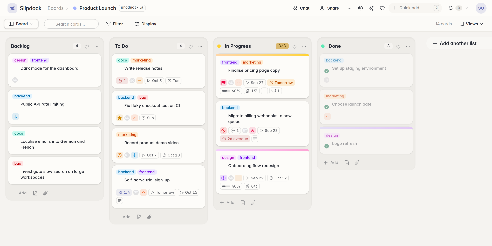
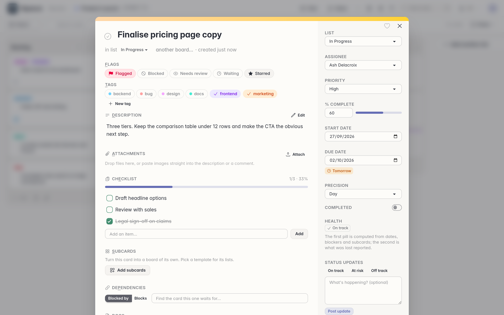
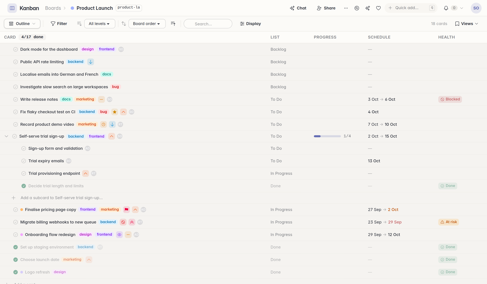
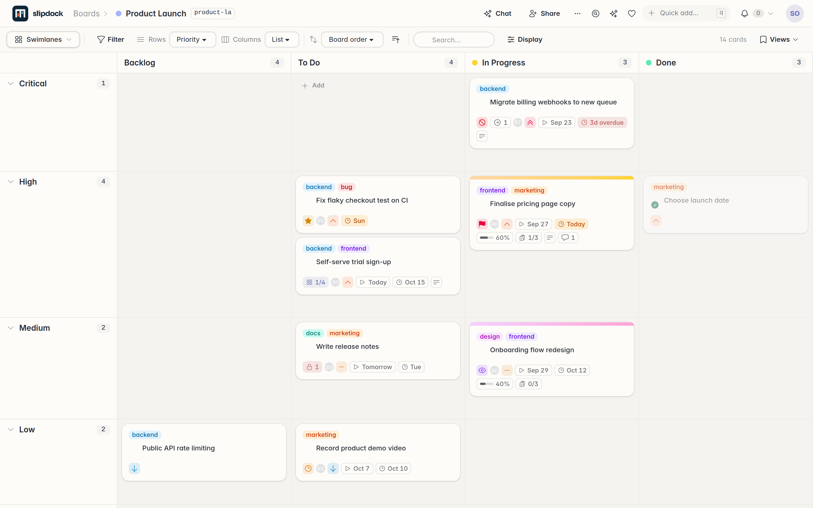
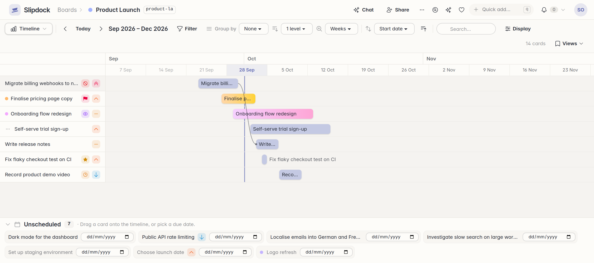
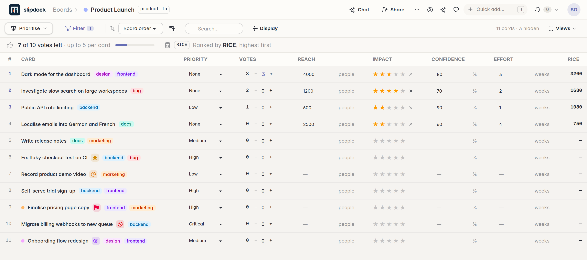
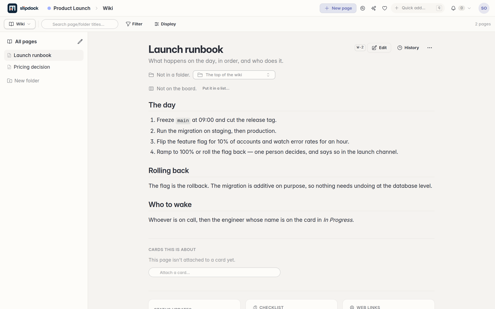
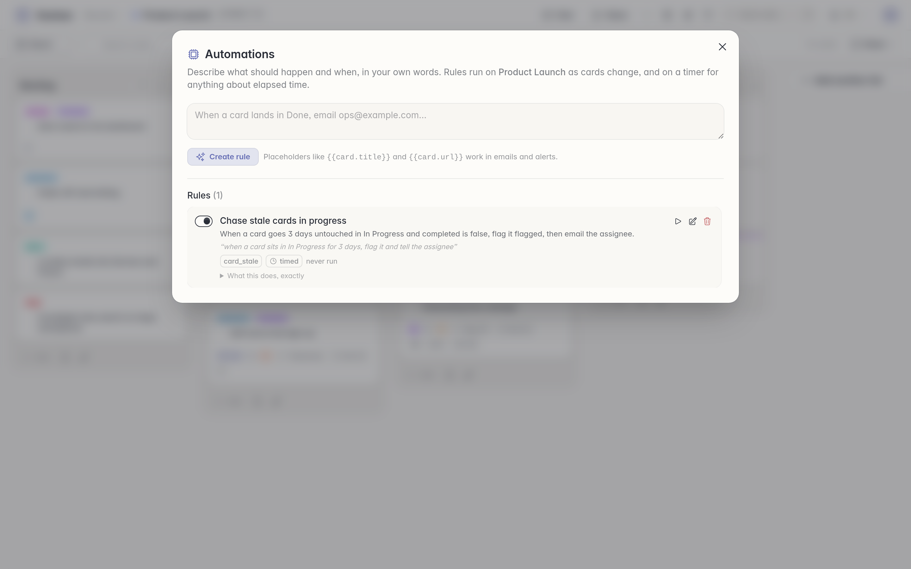
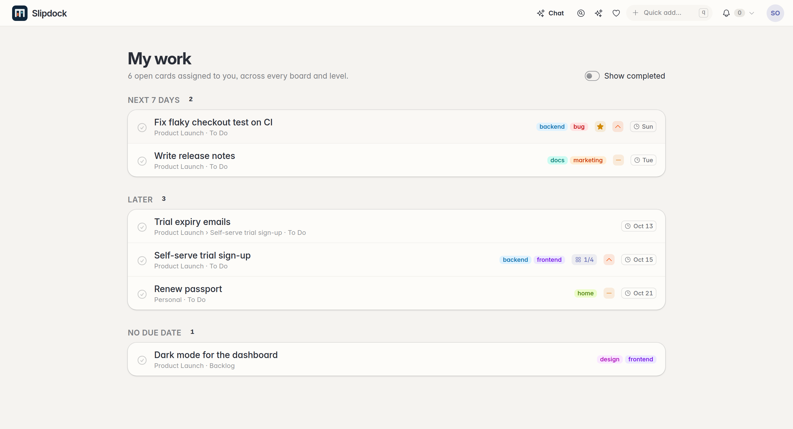

<p align="center">
  <picture>
    <source media="(prefers-color-scheme: dark)" srcset="brand/lockup-reversed.svg">
    
  </picture>
</p>

<p align="center">
  <a href="https://github.com/dadamsuk/slipdock/actions/workflows/ci.yml"></a>
  <a href="https://github.com/dadamsuk/slipdock/actions/workflows/release.yml"></a>
  <a href="https://github.com/dadamsuk/slipdock/pkgs/container/slipdock"></a>
  <a href="LICENSE"></a>
</p>

Self-hosted kanban board for people who want their work tracker to be theirs and to really help get their job done: you can easily self-host for free or use the [hosted version](https://slipdock.us). Functionality of the two is identical. It's different (better?) than most Kanban boards though, because it incorporates features built on real world experience of hundreds of projects, none of the fluff you don't need and everything that you do. This system was built for a real use case: replacing Jira Tickets, Jira Product Discovery, Jira Atlas (particularly sharing updates with stakeholders) and Confluence. And with the optional AI integrations, it's better than all of them. 



Any card can become a board of its own, so an epic and its tasks
live in one place and roll up. The same cards can be read as a board, a
swimlane grid, a table, a Gantt timeline, a calendar, an outline or a ranked
backlog. Each board carries a wiki, so the documentation/reasoning sits beside the work.
Automations are written in plain English ("flag any card which is more than 3 days overdue to urgent and send an email to John"). You can give it plain English commands too: "Split this card into 3 sub-cards", interrogate it: "Across all my boards, what tasks do I have that are slated to take less than 1 day?".  And it has semantic search: "Where's the card about the invoicing bug that came in last week" (that doesn't even mention the word invoice).  

And best of all the whole thing is available over
a JSON API and a CLI, so an agent can work the board the way a person does.  Chat with Claude or ChatGPT about your work, get it to create your cards, run loops off the back of them.  Whatever you need.

## A word on AI coding...

Of course it was built using AI. But it wasn't vibe coded in an hour. First it was born of 30+ years of experience of managing projects and writing software. Second it was planned out and carefully constructed with robust testing and verification.  And third it has been security reviewed by multiple different coding agents. 

> A plan is falsework: the structure that holds the thing up while it is being built, and comes away when it stands on its own. This is somewhere to put it.

Built with Phoenix LiveView, so every browser looking at a board updates the
moment anything changes.

## A look around

| | |
|---|---|
|  **A card** — flags, tags, checklist, dependencies, roll-up health, status updates |  **Outline** — the board as a tree, subcards and all |
|  **Swimlanes** — any attribute on either axis |  **Timeline** — Gantt bars, dependency lines, draggable |
|  **Prioritise** — RICE, ICE and votes, edited in place |  **Wiki** — Markdown pages on the board, with revisions |
|  **Automations** — a sentence becomes a rule |  **My work** — everything assigned to you, across every board |

There are more in [docs/screenshots](docs/screenshots), the phone layout
included. They are taken from a demo workspace anybody can rebuild —
`tools/screenshots.sh` makes a throwaway database, fills it with
`mix slipdock.demo`, runs a server of its own and photographs it.

## What it does

Briefly, with the detail in [the manual](docs/manual.md):

- **Boards, lists and cards** — drag and drop, priorities, five flags, due
  dates, tags, checklists, comments with `@mentions` that email the person
  named, attachments (uploaded in the browser, or over the API and CLI —
  `slipdock attach 12 shot.png`, and back with `slipdock download 5`), image thumbnails on card fronts, recordings that
  play in place and transcribe on a transcription server of your own
  (Configuration → Server → Transcription server; [what it must speak](docs/manual.md#what-a-transcription-server-must-speak)), which can be taught the voices you name in transcripts, cover colours and a colour for each edge of a card (which the AI chat and automations can set too), archive and restore (the archive searchable by title, `#id` or a card's link), and a [select mode](docs/manual.md#changing-several-cards-at-once) that tags, flags, moves, archives or deletes many cards at once. Each board has a short code (`qvm-v1-rem`) that addresses it
  everywhere.
- **Where it was left** — [a handoff on every card](docs/manual.md#where-it-was-left-handoffs):
  the one next step and a short note (state, gotchas, open questions,
  pointers), shown just beneath the card's title and marked on its front, so whoever picks
  it up next — you, a colleague, an agent or a runner — reads that instead of
  the comments. Written from the card, `slipdock handoff 12 --next "…"`,
  `POST /api/cards/:id/handoff` or the MCP `leave_handoff` tool; a runner job
  that stops short leaves its summary as one. One left by mistake can be
  deleted outright (Delete on the card, `slipdock handoff 12 --delete`), and
  the one before it is current again; any earlier one can be restored from the
  history. The note is Markdown, as comments are. A board can rename *Left off*
  and give Auto generate its own instructions (settings → Handoffs,
  `slipdock set-board --handoff-label / --handoff-prompt-file`).
- **Waiting on a person** — [a wait on a card](docs/manual.md#waiting-on-a-person-waits):
  what it needs, from whom (or anyone), since when, and optional answer
  choices. It flags the card `waiting`; answering it on the card, in My work,
  with `slipdock answer 12 --choice 1`, `POST /api/cards/:id/wait/answer` or
  MCP `update_card`'s `answer_wait` posts the answer as a comment and gets the
  work going again. Opened with `slipdock wait 12 "Which region?" --choice eu
  --choice us`, `POST /api/cards/:id/wait` or `update_card`'s `wait` — the way
  agents are told to ask. Several questions are asked as a numbered series
  (`--question`, `questions`), each with its own answer box, a ✨ button that
  suggests an answer from the card, and **Skip** to move on without answers;
  **Ask questions** asks them from the card, and the card keeps every
  question asked before with its answers (`slipdock waits 12`). **Waiting on you** opens My work with everything that
  needs you, oldest first (waits, `review` and `waiting` flags on your cards,
  runner trouble, cards in progress with nobody on them), and the header counts
  it on every page; `slipdock work` and `GET /api/work` list the same.
- **Multiboard** — the top N cards of lists picked from any of your boards,
  on one page from the home page's toolbar, laid out by board, by list or as
  a grid of tiles. The view is remembered and lives in the URL, so it can be
  bookmarked; `slipdock multiboard` and `GET /api/multiboard` show the same.
  A view can be **saved** with a name and a colour: it then sits on the home
  page among your boards and vaults, dragged into place like they are
  (`slipdock save-multiboard`, `/api/multiboards`).
- **A board's pulse** — [flow numbers from every move](docs/manual.md#flow-the-pulse-a-cards-state-and-its-age):
  each card move is recorded with who made it (a person, an agent or an
  automation), and the board works out what is in progress, what waits on a
  person, what got done this week, typical time to done and each list's usual
  stay. `slipdock pulse <board>`, `GET /api/boards/:id/pulse` or `get_board`
  with `pulse: true`; a plain-words strip over the lists if the owner turns it on.
- **Visualise** — [one page for a board's flow](docs/manual.md#visualise-flow-velocity-runners-and-delivery):
  pick *Visualise* from the board's view menu for its pulse tiles, a block per
  list with traffic and usual stay, cumulative flow, velocity, backlog burndown
  and cycle time over 7, 30 or 90 days, aging work in progress, the work mix
  by tag, how its agentic runners are doing (status, queue wait, success, waits
  on people, recent jobs) and its DORA numbers. Worked out when you open it.
  The same history and runner numbers: `slipdock flow <board> [--days N]`,
  `slipdock runner-stats <board>`, `GET /api/boards/:id/flow?days=` and
  `/runner_stats`, or `get_board` with `history: true` or `runners: true`.
- **Delivery metrics (DORA)** — [deploys recorded from CI](docs/manual.md#delivery-metrics-deploys-and-dora):
  wrap your deploy step in `slipdock deploy run --env production -- ./deploy.sh`
  and the board records each deploy with the commits since the last one, then
  reports deployment frequency, lead time for changes, change failure rate,
  time to restore, rework rate and **idea to production** (a card first in
  progress → the first deploy that names it), each with its DORA band. Cards a
  deploy names show *Shipped to production · 1a2b3c4 · 19 Oct*; incidents are
  ordinary cards tagged `incident`. Off until the owner turns **Delivery
  metrics** on; **Track deployments** in board settings (or `slipdock deploy
  setup <board>`) issues a deploy token that can record deploys and nothing
  else, writes the CI step — GitHub Actions, GitLab or plain shell — and gives
  a prompt for Claude Code to wire it up. `slipdock dora <board>`, `GET
  /api/boards/:id/dora` or `get_board` with `dora: true`; `slipdock deploy
  backfill --from-tags` for day one.
- **Recurring cards** — [repeating work kept on the card](docs/manual.md#recurring-cards)
  ("every Monday: review invoices", "the last Friday of the month", "three days
  after I last did it"): the next one is a copy of the current one, checklist
  unticked and subcards reopened, made in your timezone; one still open when the
  next is due has its due date moved on rather than six piling up. **Repeat…**
  on the card, `every: mon` in quick add, `slipdock repeat 12 "every mon"`,
  `PUT /api/cards/:id/recurrence` or MCP `update_card`. **Duplicate** makes the
  same copy by hand.
- **Snooze** — [hide a card until a day](docs/manual.md#snoozing-cards) and have
  it come back at the top of its list: one keystroke (`z`, `z z` for tomorrow)
  takes a card that isn't actionable yet out of the lists, My work and the
  runners' pick. Each list's foot counts its sleepers and shows them faded on a
  click; search, the calendar and roll-ups still see them, and someone else's
  comment wakes one early. `snooze: mon` in quick add, `slipdock snooze 12 next
  week`, `POST /api/cards/:id/snooze` or MCP `update_card`'s `snoozed_until`.
- **Tidy up** — [the board finds its own rot and proposes the fix](docs/manual.md#tidying-up):
  epics done but still open, Done cards never completed (or completed ones
  outside Done), cards stuck in progress, epics with no next step, long-overdue
  and abandoned cards, likely duplicates (from the stored search vectors, no
  model call), pages nothing links to and `[[links]]` with a typo. You apply or
  dismiss each suggestion, a dismissal stays dismissed until its subject
  changes, and an applied one can be undone. A *Weekly tidy-up* rule raises an
  alert with the count and applies nothing. `slipdock garden <board> --run`,
  `POST /api/boards/:board/garden` or MCP `garden` / `garden_decide`.
- **Time tracking** — [a timer on each card, time spent and an estimate](docs/manual.md#time-tracking)
  in minutes, hours, days, weeks or months, and a bar that turns amber near the
  estimate and red past it.
- **Subcards** — [any card becomes a board of its own](docs/manual.md#subcards-and-templates),
  nesting as deep as the work does, and
  [rolls up](docs/manual.md#roll-ups-the-outline-and-my-work): leaves done,
  effective dates, slip, blocked-anywhere-below, health.
- **Simple boards** — [one setting](docs/manual.md#simple-boards) turns a
  board into a plain to-do list, hiding % complete, start dates, health, time
  tracking, votes, dependencies and the timeline and prioritise views.
- **Default view** — [a board can open on](docs/manual.md#a-boards-default-view)
  its wiki, table, calendar or any other view instead of the kanban.
- **Sprints** — [a sprint board](docs/manual.md#sprints) where each card is a
  sprint: **New sprint** dates the next one, and **Add cards…** opens a
  planning view over the boards and lists you plan from — priority, RICE and
  other scores, votes and estimates side by side, epics opening in place, with
  running totals of what is ticked against what the sprint holds — or ticks
  work from any other board into it, as many sittings as it takes, each card
  leaving a live stand-in on the board it came from;
  **Charts** draws each sprint's burndown and the board's velocity.
- **Seven views** of the same cards —
  [board](docs/manual.md#features), [swimlanes](docs/manual.md#swimlanes),
  [table](docs/manual.md#table), [timeline](docs/manual.md#timeline),
  [calendar](docs/manual.md#calendar),
  [outline](docs/manual.md#roll-ups-the-outline-and-my-work) and
  [prioritise](docs/manual.md#prioritise) — each with filters, display
  options and saved views that can be shared or published.
- **Planning** — [dependencies with cycle detection, list categories and
  horizons, milestones, custom and formula fields (RICE, ICE, value/effort),
  budget voting, typed links and goals](docs/manual.md#roadmapping).
- **A wiki per board** — [Markdown pages in a tree of folders](docs/manual.md#wiki),
  written in an Obsidian-style live-preview editor (descriptions and comments too),
  that stays quick with thousands of notes (loaded a folder at a time, only the rows
  on screen drawn), icons and colours on folders and pages, `[[links]]` (typing `[[` opens a page picker: by title, folder or `W-` code, recent first, across every vault you have), live card chips, live query blocks, backlinks, revisions,
  templates, export and public links. Several boards' wikis can be laid out as
  one [vault](docs/manual.md#vaults), a folder tree of Markdown (and other)
  files, the way Obsidian keeps notes (Obsidian itself isn't needed): links, `#tags`, aliases,
  embeds and front matter as Obsidian reads them, a page or a whole folder filed in several
  folders, and [`slipdock sync`](docs/manual.md#syncing-a-vault-to-a-folder)
  to mirror it both ways to a folder on each computer, Obsidian included (or one way,
  `sync from-server` / `sync to-server`), after
  a one-time [import](docs/manual.md#importing-an-obsidian-vault) of the vault you have,
  Excalidraw [drawings](docs/manual.md#drawings) drawn in the page and drawn
  in together live, with everyone's pointers on the canvas,
  [meeting pages](docs/manual.md#meeting-recordings-from-google-drive) that play
  their recording from Google Drive in step with the transcript (whose voices
  you can name in place), and
  [encrypted notes](docs/manual.md#encrypted-notes) in Meld Encrypt's format, encrypted and
  decrypted in your browser or the CLI so the server never sees them. Plus a
  [Narrative view](docs/manual.md#narrative) that tells you what happened to a
  set of cards over a date range.
- **Automations** — ["when a card lands in Done, email the team"](docs/manual.md#automations-and-alerts),
  parsed once by a model and then run by the app — or picked from ready-made
  ones (follow a board, a list or a card; reminders; tidying) with a short
  form and no model at all — with alerts in the header
  and callbacks (GET or POST, with the card's title, link, dates, flags and
  status) out to anything else you run, each one logged with what came back.
- **Email a card in** — [your own addresses for each board, and one for Quick
  Add](docs/manual.md#emailing-your-board): forward a message and it is a card,
  attachments and all, or mail the board's page address and it is a wiki page
  (`[Folder] Title` files it, `+ Title` adds a dated section to that page),
  and [reply to a notification](docs/manual.md#replying-to-a-notification)
  to comment on its card or answer a wait. A board's owner can list
  permitted senders who may mail its card address too
  (needs [Receiving email](#receiving-email)).
- **Semantic Search** - find what you're looking for even when you can't remember exactly what it is.
- **AI, on your own key — or your own hardware** — [chat about a board, ask
  questions in prose over every board at once, search by meaning rather than
  substring, and an edit mode you approve before it applies](docs/manual.md#ai-assistant).
  Bring an OpenRouter key, or point it at any OpenAI-compatible endpoint of
  your own — LM Studio, Ollama, llama.cpp, vLLM — and nothing leaves your
  network at all. Neither one, no AI features; nothing is sent anywhere
  without one.
- **Built for the keyboard and the phone** — [a command palette, a key for
  every board and vault, Ctrl-Shift-digit hotkeys, card labels you can jump to](docs/manual.md#keyboard),
  [boards and vaults pinned to the header as icons](docs/manual.md#header-links), and
  [a layout below 640px that is a pager rather than a sideways
  scroll](docs/manual.md#on-a-phone).
- **A tour that is made of the thing it describes** — the first time somebody
  signs in they get a **Getting Started** board:
  [a dozen cards explaining the app](docs/manual.md#getting-started), with an
  epic, subcards, a working automation and three wiki pages, so nobody meets a
  blank page and the explanation of flags is a card with flags on it. Archive
  it when you are done; `slipdock welcome` brings it back.
- **Accounts and sharing** — [passwordless sign-in (an emailed link or code, or
  a passkey), groups, and read-only, comment-only (discuss without
  editing) or editable grants on a board, a single card, a wiki page or a saved
  view](docs/manual.md#accounts-and-sharing). A wiki page or a whole folder
  can be [shared on its own](docs/manual.md#sharing-pages-and-folders), to a
  person or a group: it shows under their **Shared with me** without the rest
  of the board along with the images and files the page embeds, a share to
  edit can't delete, move out or pass anything on, and a synced vault gets link stubs rather than the content. A board somebody shared with you
  says whose it is on your board list, so a list of boards is never a list of
  boards of unknown provenance, and its *…* menu has a **Shared** page saying
  who handed it over with a **Discard** button that gives the access back —
  plus
  [a device flow for signing an agent in](docs/manual.md#signing-an-agent-in)
  from anywhere, with scoped, expiring, revocable tokens.
- **Boards that can leave** — [a whole board tree as one JSON file another
  Slipdock reads back](docs/manual.md#moving-boards-between-servers): lists,
  cards, subcards, tags, checklists, comments, custom fields, dependencies and
  the wiki. Plus the wiki on its own as a folder of Markdown, and everything
  you have as a zip. Nothing here is a one-way door — and boards can arrive
  too: [a Trello board's JSON export](docs/manual.md#from-trello) imports as
  it is, lists, cards, labels, checklists and comments.
- **A JSON API and a CLI** — [everything the UI can do](docs/manual.md#json-api),
  [from the shell](docs/manual.md#cli) (on Windows, `irm <server>/cli/install.ps1 | iex`
  installs the CLI from your own server), plus
  [agent skills](docs/manual.md#skills) the server ships (for ChatGPT too,
  as zips that use the MCP connector instead of the CLI) and a
  `/api/guide` that describes *your* boards to whatever is driving them.
- **An MCP server** at `/mcp`, so claude.ai, the Claude apps, Claude Code
  and other MCP clients get the board as a small set of tools: reading,
  searching, and adding, moving, commenting on, completing and archiving
  cards, with their dependencies and checklists. Add it
  as a connector by its address and sign in through the browser (OAuth), or
  connect with an API token ([the tools](docs/manual.md#mcp-server),
  [connecting](docs/agents.md#over-mcp)).
- **Meeting and chat capture**, when an admin turns on meeting mode, for the people
  they turn it on for (admins always have it) — send a meeting's
  recording or transcript (WebVTT, SRT, Fireflies, Otter) and it proposes the
  decisions, actions and card changes in it, read alongside the board's cards
  and wiki: every proposal quoted word for word from the transcript, anything
  uncertain asked as a question, nothing written until a person commits it in
  one write that can be undone as a whole, and a *From a meeting* trail back to
  the words on every card it touches ([how it works](docs/manual.md#meeting-capture)).
  Voiceprints, if an admin turns them on, are each person's own choice: opted
  into with their consent recorded, only the embedding kept, deletable at any time.
  A conversation with Claude or ChatGPT goes the same way (chat capture, on by
  default, no meeting mode needed): the model in the chat sends it with
  `capture_chat`, or you send a paste or an export, and the decisions and
  to-dos you agreed to land on the board — quoted, and committed only when you
  say so ([capturing a conversation](docs/manual.md#capturing-a-conversation)).
- **An agent on your board in a minute** —
  [setting one up](docs/agents.md) needs no software and no access to the
  server: give it the address, approve it once in the browser, and it reads the
  server's own guide for the rest. The app has the same thing with your address
  filled in, under **Set up an agent**, and **Help → Agents** (`/help/agents`,
  readable signed out) compares the ways in — the guide and API, MCP, the CLI,
  skills, runners and webhooks — and says when to reach for each.
- **Help inside the app** — `/help`, readable without an account: short guides
  to boards, the wiki, sharing, automations and the AI features (asking about a
  board, searching and asking across every board), and to connecting agents.

## Running it

### With Docker

You need **Docker** with the Compose plugin; `docker compose version` should print v2 or newer.

#### Linux

**1. Get the two files.**

```sh
mkdir slipdock && cd slipdock
curl -O https://raw.githubusercontent.com/dadamsuk/slipdock/main/compose.yaml
curl -O https://raw.githubusercontent.com/dadamsuk/slipdock/main/setup.sh
```

There is no need to clone the repository: the image is published and
`docker compose up` pulls it. (Cloning works too, and is what you want if you
mean to change something — see *Building it yourself* below.)

**2. Answer five questions.**

```sh
sh setup.sh
```

It asks the address people will use, whether something like Cloudflare or nginx
terminates TLS in front of it, which port to listen on, your email address, and
whether you have a mail server. Then it writes a `.env` you can edit by hand
afterwards if you want to change anything. 

**3. Start it.**

```sh
docker compose up -d
```

Whenever you change `.env` afterwards, run that same command again. **Not
`docker compose restart`** — that reuses the existing container and re-reads
nothing, which makes a setting look as though it did not work.

#### On Windows

**1. Get the two files.**

```powershell
curl.exe -O https://raw.githubusercontent.com/dadamsuk/slipdock/main/compose.yaml
curl.exe -O https://raw.githubusercontent.com/dadamsuk/slipdock/main/setup.ps1
```


**2. Run the setup script.**

```powershell
powershell -ExecutionPolicy Bypass -File setup.ps1
```

The `-ExecutionPolicy Bypass` is because Windows refuses
downloaded scripts by default

`setup.sh` from the Linux instructions should work if you have **WSL** or **Git Bash**.

**3. Start it.**

```powershell
docker compose up -d
```

Whenever you change `.env` afterwards, run that same command again. **Not
`docker compose restart`** — that reuses the existing container and re-reads
nothing, which makes a setting look as though it did not work.

#### Linux and Windows

**4. Set it up.** Open the address you gave it. A server
nobody has claimed shows a **setup wizard**, which asks for a token printed in
the log the first time it starts:

```sh
docker compose logs slipdock | grep -A4 "has not been set up"
```

The wizard asks three things — who may register, how mail goes out, and
your own email address.  You can change these settings later from the admin menu.

**5. Sign in.** Until a mail server is configured, your sign-in code is written
to the log rather than emailed:

```sh
docker compose logs slipdock | grep "Sign-in"
```

#### Doing it without a browser

`setup.sh` asks for your email address and writes `SLIPDOCK_ADMIN_EMAIL`, which
is what skips the wizard. By hand, these do the same:

```sh
SLIPDOCK_ADMIN_EMAIL=you@example.com     # becomes the admin; skips the wizard
SLIPDOCK_SIGNUP_MODE=closed              # open | allowlist | approval | closed
SLIPDOCK_SMTP_HOST=smtp.example.com      # and _PORT, _USER, _PASSWORD, _FROM
```

Or afterwards, from the command line:

```sh
docker compose run --rm slipdock setup --admin you@example.com
docker compose run --rm slipdock setup --status
docker compose run --rm slipdock setup --sign-in-link you@example.com
docker compose run --rm slipdock setup --make-admin you@example.com
```

Use the sign-in-link option if emailing a link isn't working.  

#### Behind a TLS proxy

The container speaks plain HTTP on port 4000 and assumes something in front of
it terminates TLS.

```sh
SLIPDOCK_URL_SCHEME=https
SLIPDOCK_URL_PORT=443
SLIPDOCK_PUBLISH=127.0.0.1:4000   # only the proxy needs to reach it (the default)
```

The visitor's own address, which the sign-in limits and the API token audit
use, is taken from `X-Forwarded-For` — but only when the request arrives from
a trusted proxy: by default loopback and the private ranges, which covers a
proxy on the same host or in the same Docker network. If yours connects from
a public address (Cloudflare proxying straight to the origin, say), list its
ranges in `SLIPDOCK_TRUSTED_PROXIES`, comma-separated; otherwise everybody
appears to come from the proxy and shares one sign-in limit. `none` trusts
nobody.

If people reach the server by more than one name, list the others in
`SLIPDOCK_CHECK_ORIGIN` — live updates are refused for names you did not
mention, which looks like a page that loads but never changes.

To make the app force HTTPS itself, build it with
`--build-arg SLIPDOCK_FORCE_SSL=true`.

#### Which build is running

**Configuration** shows, at the top of the page, when the running build was
compiled and the commit it came from — the first thing worth checking when a
server is not behaving the way the code in front of you says it should.
`slipdock admin build` prints the same line from a terminal.

There is no `.git` inside the image, so a Docker build has to be told the
commit:

```sh
docker build --build-arg SLIPDOCK_GIT_SHA=$(git rev-parse HEAD) .
SLIPDOCK_GIT_SHA=$(git rev-parse HEAD) docker compose build   # the same, via compose
```

The published images are built with it.

Without it the commit reads `unknown`, which is the honest answer rather than
a wrong one.

#### Upgrading

```sh
docker compose pull
docker compose up -d
```

Migrations run themselves on boot. Read [UPGRADING.md](UPGRADING.md) first — it
says what changed and what, if anything, you have to do.

`latest` follows the main branch. To pin a version instead, set `SLIPDOCK_TAG`
in your `.env` to any published tag.

Tabs left open across an upgrade reconnect by themselves, but they are still
running the old stylesheet and scripts. Each one shows a "Slipdock has been
updated" bar at the top with a Reload link; until it is reloaded, new features
can look broken there.

While the new container starts, which takes a few seconds, nothing is
listening, so a proxy in front answers with a 502. To have those requests wait
instead, put Caddy in front. It is optional and self-contained:

```sh
cp deploy/caddy/compose.override.yaml deploy/caddy/Caddyfile .
docker compose up -d
```

Compose reads `compose.override.yaml` by itself. Caddy takes over the port in
`SLIPDOCK_PUBLISH`, and the app is then reached only over the compose network.
Upgrading is the same two commands as before: only the app is recreated, and
Caddy keeps retrying each request for up to 30 seconds until the new container
answers. Runners waiting for a job are answered before the old container
stops, and ask again a second later. It trusts the private ranges in front of it, so `X-Forwarded-For`
and `X-Forwarded-Proto` from a tunnel or host proxy pass through unchanged.
It needs Docker Compose 2.24 or later.

`deploy/deploy.sh <tag>` is the same upgrade pinned to one image
(`sha-<commit>` or a release version like `1.2.3`): it pulls and recreates the
app alone, leaves Postgres running, records the tag it replaced, and prints the
running digest, so `deploy.sh <previous-tag>` is the rollback. The release
workflow's `deploy` job runs it on the project's own server over Tailscale SSH
after each push to main or a `v*` tag, then waits for `GET /healthz` to report
`ok` on that commit. `/healthz` answers `{"status":"ok","sha":…}`, or 503 when
the database does not answer. Rolling back the image does not roll back the
schema: migrations only go forward.

#### Backing up

There are two volumes. `slipdock-db` is the Postgres database; `slipdock-data`
holds uploaded files, each person's AI key and endpoint, and a
`SECRET_KEY_BASE` the container generates for itself on first run. **Those
volumes are the only copy**, and backing them up is the one piece of
maintenance this app asks of you.

The database is backed up with `pg_dump` rather than by copying its files,
because a dump is consistent and restorable into any later Postgres:

```sh
docker compose exec -T postgres pg_dump -U slipdock -Fc slipdock > slipdock-db.dump
docker compose stop
docker run --rm -v slipdock_slipdock-data:/data -v "$PWD":/backup alpine \
  tar czf /backup/slipdock-backup.tar.gz -C /data .
docker compose start
```

The volume is named after the compose project, which `compose.yaml` pins to
`slipdock` — so it is `slipdock_slipdock-data` wherever you put the directory.
Check with `docker volume ls` if in doubt; backing up a volume name that does
not exist produces a cheerful, empty archive.

To restore, stop the app, then untar into the same volume with
`tar xzf /backup/slipdock-backup.tar.gz -C /data`.

#### Administrative tasks

A release has no `mix`, so the ones worth having are on the entrypoint:

```sh
docker compose run --rm slipdock setup --status   # what this server allows
docker compose run --rm slipdock ai-key           # who has an AI key
docker compose run --rm slipdock reindex          # rebuild the search index
docker compose run --rm slipdock welcome you@example.com   # the Getting Started tour board
docker compose run --rm slipdock migrate          # migrations, by hand
docker compose run --rm slipdock remote           # an IEx shell in the running app
```

#### Building it yourself

The image is built for `amd64` and `arm64`. For anything else, or to run your
own changes:

```sh
git clone https://github.com/dadamsuk/slipdock.git
cd slipdock
SLIPDOCK_GIT_SHA=$(git rev-parse HEAD) docker compose build
docker compose up -d
```

The first build takes a few minutes — it compiles the app and its assets — and
later ones reuse most of that. Set `SLIPDOCK_PULL_POLICY=missing` in `.env` so
that `up` stops reaching for the published image.

#### If something is wrong

| What you see | What it usually is |
|---|---|
| `/setup` gives a 404 | The server is already set up. `setup --status` says by whom; `setup --sign-in-link` gets you in. |
| "not allowed to sign up here" for your own address | That address has no account and registration is closed. `setup --make-admin you@example.com` makes one (or re-enables it if it was disabled), makes it an admin, and prints a way in. |
| Every page redirects to `/setup` | The opposite: it has never been claimed. Finish the wizard. |
| The wizard will not take the token | It is in the log from the **first** boot: `docker compose logs slipdock \| grep -A4 "has not been set up"`. |
| No sign-in email arrives | Expected until SMTP is configured — the code goes to the log. Set it under **Configuration → Email**, which will not save until a test message actually arrives. |
| The page loads but never updates | `PHX_HOST` is not the name you are reaching it by. The log says so, in a box, naming the value to set. |
| Sign-in links point at `localhost` | Same cause, same fix. |
| Links say `:4000` when you are behind Cloudflare or nginx | `SLIPDOCK_URL_SCHEME` and `SLIPDOCK_URL_PORT` describe how people reach it, not how the container listens — so `https` and `443`. `setup.sh` asks this. |
| Refused from `app.example.com` while `PHX_HOST` is `example.com` | They are different hostnames. Use the one in the address bar, or list the rest in `SLIPDOCK_CHECK_ORIGIN`. |
| You set `PHX_HOST` and nothing changed | Either `docker compose restart` (which re-reads nothing — use `up -d`), or a shell variable that was never exported. `echo $PHX_HOST` lies about that; `env \| grep PHX_HOST` does not. The container prints what it actually got: `docker compose logs slipdock \| grep entrypoint:`. |
| Reached by more than one name | Keep the main one in `PHX_HOST`, list the rest in `SLIPDOCK_CHECK_ORIGIN=a.example,b.example`. |

### Running it for other people

Slipdock is built for one person or a team who trust each other, and it will
also run as a small shared service. A handful of things make that difference,
all under **Configuration → Server**, with the people themselves under
**Users**:

- **Who may register** — closed, an allowlist, approval one at a time, or open.
- **An item limit for free accounts**, counted against the boards somebody
  *owns*, so a guest working on your board costs them nothing. An item is a
  card, a wiki page or an uploaded file — all three count, or writing the work
  up as pages would be a way round it.
- **A free trial**: free accounts stop being able to add anything so many days
  after they were made. Off by default. It is independent of the item limit —
  an account can have no item limit at all and still run out of trial, or have
  both and hit whichever comes first. Nothing is deleted and nobody is locked
  out: an expired account reads and edits everything it has.
- **What it is being used for**, under **Overview** (admins only, in the
  avatar menu's Admin group; `slipdock admin overview` from a terminal): how many accounts,
  how many joined or were active in the last 7 and 30 days, and for each
  person when they signed up, when they were last active (signing in or using
  an API token), and how many boards, lists, cards, wiki pages and files they
  own and the storage behind them. Sort the table by any column.
- **Who has paid**, per person under **Users**: a paid-up date takes somebody
  off the free allowance and off the trial clock. There is no billing in
  Slipdock; whoever takes the money sets the date.
- **Who people can see** — everyone on the server, or only the people they
  actually share a board, card or page with. The second is what stops two
  customers of one server learning that the other exists; it also keeps their
  addresses out of the prompts sent to a language model.
- **Whether sharing with a stranger makes them an account**, which is how
  somebody arrives on a hosted instance and is usually wrong on a private one.
- **Product analytics and error tracking with PostHog**, off until you fill
  in a project key (and, for the EU cloud or a proxy, a host). With one, pages
  send pageviews and their uncaught JavaScript errors, and the server sends
  its own errors and crashes (anything logged at error level, with the stack
  trace) as `$exception` events to PostHog's Error Tracking — at most 30 a
  minute, so a crash loop cannot flood the project. Without a key nothing
  about PostHog reaches a browser and the server sends nothing — no script, no
  requests, no widened Content-Security-Policy. From a terminal: `slipdock admin set
  posthog_key=phc_... posthog_host=https://eu.i.posthog.com`, and
  `posthog_key=` to turn it off again.
- **Whose AI key search and automations use.** Semantic search, the search
  index and scheduled automations run with nobody signed in, so they spend one
  admin's AI settings, chosen on the Configuration page (`slipdock admin set
  ai_system_user=you@example.com`). The page shows what is in effect and why.

#### The ceilings, which are not about selling anything

Separately from all of that, **every install has three ceilings on, however it
is run** — a server you host for yourself included:

| Ceiling | Default | Counts |
| --- | --- | --- |
| Boards one person may own | 1,000 | Root boards. Sub-boards, the ones behind subcards, do not count. |
| Items on one person's boards | 250,000 | Cards, wiki pages and uploaded files together. |
| Files on one person's boards | 10 GB | The size of every attachment behind them. |

They are a safety rail rather than a price list: a runaway script or an import
gone wrong should hit something. **Admins are not exempt** — an admin who means
to go past one raises it, which takes a moment and leaves a record of the
decision. Each has its own switch, so any of them can be turned off without
losing the number behind it, and where a free account's own allowance is lower
than the ceiling, the lower one wins.

### Settings: the environment seeds them once

Everything about *how this server behaves* — who may register, the free
allowance and the trial, the ceilings, who shows up in people pickers, whether sharing something with a
stranger makes them an account, and how mail is sent — lives in the database
now, so it can be changed from a browser without a redeploy.

The environment still configures it, but only as a **seed**: the variables
below are written into the settings the first time the server starts, and are
ignored from then on.

```sh
SLIPDOCK_ADMIN_EMAIL=you@example.com   # setting this skips the setup wizard entirely
SLIPDOCK_SIGNUP_MODE=allowlist         # open | allowlist | approval | closed
SLIPDOCK_SIGNUP_ALLOW=you@example.com,example.org   # seeds the allowlist
SLIPDOCK_FREE_CARD_LIMIT=20            # items allowed on one free account's own boards
SLIPDOCK_TRIAL_DAYS=30                 # free accounts stop adding after this long (unset = no trial)
SLIPDOCK_BOARD_LIMIT=1000              # boards one person may own; 0 or "off" for no ceiling
SLIPDOCK_ITEM_LIMIT=250000             # cards, pages and files together; 0 or "off" for none
SLIPDOCK_STORAGE_LIMIT_MB=10240        # uploaded files, in MB; 0 or "off" for no ceiling
SLIPDOCK_USER_DIRECTORY=shared_only    # instance | shared_only
SLIPDOCK_INVITES_CREATE_ACCOUNTS=false # whether sharing with a stranger makes an account
SLIPDOCK_SMTP_HOST=smtp.example.com    # and SLIPDOCK_SMTP_PORT / _USER / _PASSWORD / _FROM
SLIPDOCK_LOGIN_FALLBACK=false          # never write sign-in codes to a file (set this when public)
```

There is a command-line equivalent for an install that was not configured that
way, and a `--status` that says what the server currently thinks:

```sh
mix slipdock.setup --admin you@example.com --mode allowlist --allow example.com
mix slipdock.setup --status
mix slipdock.setup --sign-in-link you@example.com   # when mail has broken
mix slipdock.setup --make-admin you@example.com     # a server with no usable admin
```

It refuses to run on a server that is already set up — that server is already
somebody's.

**Changing one of these on a server that has already started does nothing.**
That is deliberate — a browser has to be able to win, or the settings page
would be a lie — but it does mean a variable edited after the fact looks
ignored, because it is. Change it in the app instead.

Two exceptions, which are overrides rather than seeds and win every time:
`SLIPDOCK_LOGIN_FALLBACK=false`, so a public host can forbid writing sign-in
codes to a file whatever the settings say, and `SLIPDOCK_AGENTIC_LOGIN`.

### Receiving email

Slipdock doesn't run a mail server. Cloudflare Email Routing receives mail
for a domain you own and an Email Worker (`cloudflare/inbound-email/`) posts
each message to `/api/inbound/email`, signed. Both of these are read on every
boot, and with either unset the feature is off and its endpoint answers 404:

```sh
SLIPDOCK_INBOUND_DOMAIN=in.example.com     # the domain mail is received on
SLIPDOCK_INBOUND_SECRET=…                  # shared with the Worker (wrangler secret put)
SLIPDOCK_INBOUND_SECRET_PREVIOUS=…         # still accepted while you rotate it
```

Once it is on, everybody has a `card-…@` and a `page-…@` address (a new card,
a new wiki page or `+ Title` to add to one; `[#42] …` to the card address
comments on card 42) for each board they can
write to (the board's `…` menu › *Email to this board*, `slipdock inbound
<board>`), a `page-…@` address of its own for any wiki folder (the tree's
*Email this folder…*, `slipdock inbound <board> --folder <path>`) and a personal `add-…@` address that goes through Quick Add
(Account, `slipdock inbound me`): see [Emailing your
board](docs/manual.md#emailing-your-board) for what a message becomes and why
one might bounce. A board's automations can act on what mail brings in, as
it arrives: the `card_emailed` and `page_emailed` triggers (flag it for
review, tag it, alert someone; [Rules for what mail brings
in](docs/manual.md#rules-for-what-mail-brings-in)). Emails about a card (mentions, waits, automation emails)
carry a signed `reply-…@` `Reply-To`, so a reply becomes a comment on the
card or answers the wait ([Replying to a
notification](docs/manual.md#replying-to-a-notification)); rotating the
secret retires those addresses once the previous one is dropped. Each person's last 50 inbound messages, and what came of
each (what it made, or why it bounced or was ignored), are on the account's
*Email Log* tab, at `GET /api/inbound/log` and with `slipdock inbound log`. The design
and the deploy runbook are on the Slipdock board's wiki (W-1933).

### Google Drive, for meeting recordings

A meeting page can play its recording straight from the owner's Google
Drive, in step with its transcript
([manual](docs/manual.md#meeting-recordings-from-google-drive)). Nothing is
copied to the server. Each person connects their own Drive, read-only, through
an OAuth client you make once:

1. In Google Cloud, create an **OAuth client ID** of type *Web application*,
   with the redirect URI `https://<your host>/account/google/callback`. It
   must match exactly, scheme and host included: `http://` vs `https://`, a
   port, or `www.` all count, and Google refuses the sign-in otherwise. Enable
   the **Google Drive API** for the project, then set up the consent screen:
   - **On a Google Workspace**, make it **Internal**: it then needs no Google
     verification, and its refresh tokens don't expire.
   - **On a personal Google account** (gmail.com) the consent screen can only
     be **External**. Add the `.../auth/drive.readonly` scope to it, leave it
     in **Testing**, and add yourself (and anyone else who will connect) as a
     **test user**. In Testing, Google expires refresh tokens after **7
     days**, so each person has to connect Drive again weekly; Slipdock says
     so when it happens. `drive.readonly` is a *restricted* scope, so
     publishing the app to everyone needs Google's verification (a security
     assessment). For a single-user or small install, staying in Testing is
     the practical choice.
2. Give the server its id and secret:

   ```sh
   GOOGLE_CLIENT_ID=1234-abc.apps.googleusercontent.com
   GOOGLE_CLIENT_SECRET=GOCSPX-…
   ```

   Unlike the settings above, these are read on every start. Unset, the Drive
   connection isn't offered at all.
3. People connect Drive on **Account → Settings**, and set each vault's
   recordings folder on the vaults screen (or `slipdock vault set V
   --recordings-folder PATH`).

The scope is `drive.readonly`. Tokens are stored encrypted with a key derived
from `SECRET_KEY_BASE`, so changing that key means everyone connects again. A
vault's recordings are served through its owner's connection to anyone who can
read the page, and only files under its recordings folder are served.

What a meeting page has to look like to play, for whatever records and
transcribes your meetings, is in the manual:
[Meeting transcripts: what Slipdock expects](docs/manual.md#meeting-transcripts-what-slipdock-expects).

### From a checkout

You need Elixir 1.19 or newer on Erlang/OTP 27 and a Postgres to point it at;
the asset tools install themselves. There is a compose file for the database if
you would rather not install one:

```sh
git clone https://github.com/dadamsuk/slipdock.git
cd slipdock
docker compose -f compose.dev.yaml up -d   # Postgres on 127.0.0.1:5434
mix setup          # deps, database, seeds, assets
mix phx.server     # the address it binds to is printed on start-up
```

`mix setup` seeds a demo workspace on an empty database, which is the same one
the screenshots come from (`mix slipdock.demo` builds it on demand). In
development the server binds to this machine's Tailscale address if it has one,
otherwise loopback; `SLIPDOCK_BIND_IP` and `PORT` override that, and
`DATABASE_URL` points it at another database.
[`deploy/slipdock.service`](deploy/slipdock.service) is a systemd unit template for
running a production release on boot — see [the manual](docs/manual.md#as-a-service).
Do not leave the dev server reachable by other people: its `/dev/mailbox` shows
every sign-in link it has sent.

## Run an agent against a board

A board can hand cards to a coding agent running on your own machine. An
automation rule with the **Send to runner** action (`runner`) puts the card
in a job queue; a runner on your laptop, dev server or Windows box takes
the job, runs Claude Code (or whatever you configure) on the card, and
reports back. The card shows its jobs — queued, running, done or failed,
with the tail of the log — and a Cancel button.

- **Pull, not push.** Runners dial out to Slipdock; Slipdock never calls the
  machine, so there are no ports to open or tunnels to set up, and it works
  the same for the hosted service and a self-hosted one.
- **Slipdock never decides what runs.** A job carries data — its kind, the
  card and the prompt. What each kind of job runs is in a config file on the
  runner's machine, and a kind it doesn't know is refused there.
- **A list in order, or every card that arrives.** *Send cards to a runner*
  queues each card as it lands in a list; *Work a list with a runner*
  (trigger `list_top`) keeps one job open at a time, always for the top
  ready card of the list, so a runner works your To Do list the way you
  stacked it — and, by default, waits while anything is in progress, so it
  never starts a card beside one you're working by hand. A card its job
  leaves in progress goes back on top of the list for another try, then is
  flagged blocked, so a crashed or timed-out pass never stalls the list;
  a `job_finished` rule can alert, email or call a webhook when a job times
  out or a card is given up.
- **One queue for everything.** A Claude session (`/loop`, a scheduled task), or ChatGPT through its connector,
  takes jobs from the same queue through the MCP tools `claim_job`,
  `job_progress` and `finish_job`, or `slipdock claim-job`, so it never
  races a runner for the same card.
- **A question parks the job.** An agent that needs something only a person
  can give opens a wait and stops; the job ends `parked`, its card goes back
  on top of the list flagged waiting so the next card runs, and answering the
  wait sends the card to the same rule again with the answer at the top of
  the prompt (`slipdock finish-job <job> --status waiting --needs "…"` asks and
  parks in one step).
- **A brake with a reason.** The board's owner can pause the whole tree, or
  one pool, from the Runners panel, `slipdock pause <board> [--pool P]
  --reason "…"`, `POST /api/boards/:board/pause` or MCP `manage_automation`
  `pause`. Nothing is claimed and no list sends a card until a person
  resumes it (agents can pause but not resume); every board in the tree
  shows a banner, and `get_board`/`list_cards` carry `paused`.
- **Held work says why.** A queued job, an empty claim and the card's jobs
  name one reason: paused (by whom, why), WIP full, waiting on a card in
  progress, or no runner online for its pool. With *WIP limits hold
  automated work* on in the board's settings (`automation_wip`), a full
  first in-progress list holds jobs and list sends for cards not already in
  progress; people can still drag cards in.
- **Each card says what is happening to it.** A tile shows one state line
  when a job or a wait is on it ("Running · runner-2 · 7m", "Waiting on
  Dana · 41m", "Held · paused by David: bad deploy", "Failed · … · Next: …"),
  an agent or person mark on trees with runner rules, and an age chip for
  its time in the list that turns amber past the list's usual stay. The
  same `state`, `driver`, `age` and `stuck` come back from REST, MCP and
  `slipdock cards`, which filter on `stuck` and `driver` (`--stuck --driver
  agent`), as does the board's Filter menu.
- **Each card has a timeline.** Near the bottom of the card, lanes on one
  time axis show each list it has sat in (coloured by the list's category,
  with who moved it), each wait on a person and each runner job, from its
  first record to now. The same spans come from `GET
  /api/cards/:id/timeline`, MCP `get_card` with `timeline: true` and
  `slipdock timeline <id>`.

Set one up on the board under **Automations → Connect a runner**: pick a
Linux or macOS machine (a POSIX `sh` + `curl` runner, as a systemd or launchd
service), a Windows machine (a PowerShell runner, started by Task Scheduler,
no admin), Claude Code in a `/loop`, Claude on a schedule (a Desktop task
or a cloud routine), or ChatGPT (its Slipdock connector and a prompt for a chat
or a scheduled task; no repository, so no commit or push), and it gives you exactly what to paste — and can add the
rule that sends a list's cards, plus standing instructions and before/after
hooks for every job — and a prompt that has Claude Code on the machine write
those hooks for you (your notifier, what to keep from each pass), from a
worked example. A Claude runner may use the Slipdock MCP tools without
asking (on by default) and every job is told nobody will answer questions, since
nobody is watching — to open a wait and stop if it needs a person, and to take
nothing more once the board is paused — and to leave a handoff if it stops with the card unfinished
(a job that ends with its card open leaves its summary as one). A runner costs nothing while it waits; the Claude and
ChatGPT options need no install but use a turn per check. In every scenario a job
does nothing to its card or repository unless you tick it: move it to In
Progress, assign it, git commit, git push (with commit; commits only ever in a
git repository), move it to Done, mark it complete, mark it 100%. Unticked ones
are said in the prompt as don'ts, since the skill would otherwise do them. How
much it writes on the card defaults to Nothing: no comments, just the job's
lease renewed (the server's own notes, such as a card put back or given up on,
still appear). Until a Claude session takes its first job, its pool shows in the
runner list as waiting.
One machine can run several runners — one per board, say: the steps install
each under a name of its own (its board's code and pool, as in
`--name slipdock-loop`), with its own config and service, so setting up a
second never replaces the first.
`slipdock runner new <board> [name] --pool default [--scenario …]` prints the
same, `slipdock runner ls|show|setup|token|rm` manage them, and `slipdock jobs
<board>` shows what they're doing. The details are in
[the manual](docs/manual.md#runners).

## Tools

A **Tool** is a ready-made way of working that somebody publishes on a server
for the other people on it: a board blueprint (lists with their roles, wiki
folders, tags, page skeletons and automation rules), the agent skills that
use that board, files, and a README. The example kept here is
[`packages/job-search`](packages/job-search), an automated job search whose
skills are stubs that fetch their procedure from the server when they run, so
publishing a new version reaches everyone without a reinstall
([`docs/tool-packages.md`](docs/tool-packages.md) is the package reference).
[`packages/job-scan`](packages/job-scan) is the version it replaced.

- **The server builds the board.** Installing a Tool — `install_tool` over
  MCP, `slipdock tools install-board`, or **Make the board** on its page — has
  Slipdock build the board from the blueprint, the same way every time, and
  answers with its code. A Tool's setup skill calls it first and then
  interviews the person to fill the pages in. Installing again finds the same
  board; installing a newer version adds what is missing and never
  overwrites a page somebody edited.
- **The handbook.** One Tool is built in: `handbook` puts a `Handbook/`
  folder on an existing board's root (`slipdock tools install-board handbook
  --board B`, or `install_tool` with `board`): pages for the specification,
  architecture, UX, components, data model, shared modules, testing and
  operations, one page per decision, and an Index that lists them. On that
  board `slipdock card`, `get_card` and `GET /api/cards/:id` hand each card
  the sections to read before building (`slipdock handbook <board|card>`),
  and the loop closes each card through a docs gate, with a `Handbook:`
  line. A Seed card drafts the pages from the code, and a weekly Reconcile
  card catches drift.
- **Every client.** A Tool's page at `/tools/<name>` walks through installing
  it from claude.ai (a skill zip to upload), Claude Code
  (`slipdock tools install <name>`) and ChatGPT (a zip that names the
  connector's tools), each ending with "Set up … for me."
- **Read before you run.** A Tool is instructions that run in someone else's
  agent with their access, so its page shows every skill file in full before
  anything is installed; versions are immutable and identified by a sha;
  a Tool is private to its owner until shared by grant, and listing it for
  everyone on the server takes an admin's approval of each version.

- **Files at run time.** Any file of a Tool is one request away, by its path
  in the package (`GET /api/tools/<name>/files/skills/<skill>/SKILL.md`, or
  `list_tools` with `file` or `skill`), and from the latest version unless asked;
  `link: true` gives a single-use download URL for a file, a skill's zip or the
  skills tarball, for an agent that has the MCP connector but no API token. So a
  small stub skill can fetch its procedure as it runs, and a new version
  reaches everyone without a reinstall. A Tool's board files are read from
  the board's `Tool` folder with `GET /api/boards/<board>/files/<path>`.
- **The whole package back.** `GET /api/tools/<name>/package.tar.gz`
  (`slipdock tools download <name>`, `list_tools` with `package: true`, or
  **Download the package** on its page) is every file of a version at its
  path, ready to change and publish again.

`slipdock tools publish <folder>` publishes one, or upload its `.tar.gz` under
**Publish a Tool** on the Tools page (a Tool's own page takes its next
version). The package format, every
endpoint and a worked example are in
[Tool packages: the reference](docs/tool-packages.md); the overview is in
[the manual](docs/manual.md#tools).

## Connecting an MCP client

Every install is an MCP server at `https://your-server/mcp` (stateless
Streamable HTTP). In claude.ai or the Claude apps: **Settings → Connectors →
Add custom connector**, give it that address, press **Connect** and approve it
in the browser. A connector keeps the tool and prompt lists it had when it was added, so
after an upgrade that adds tools or prompts (the job tools, say), disconnect and
connect it again (in Claude Code, restart it). In Claude Code:

```sh
claude mcp add --transport http slipdock https://your-server/mcp   # then /mcp to sign in
# or, with a token from Account → API tokens:
claude mcp add --transport http slipdock https://your-server/mcp \
  --header "Authorization: Bearer <token>"
```

The client gets 52 tools — `whoami`, `get_guide` (a short guide that names
the rest of its sections, one call each with `section`), `list_boards`, `get_board`,
`list_cards` (with `full: true`, every card as `get_card` gives it), `get_card`,
`search`, `ask` (a question in prose, answered from the boards with what it read — a model call on your AI key, so slower), `read_page`, `list_pages` (a board's wiki, flat or as a tree), `page_info` (a page's links or heading paths,
a board's wanted pages, or whether a title has a page), `page_history` (a page's revisions,
the diff one save made, or between any two), `list_vaults` (your vaults, or where a vault path lands), `activity`
(a board's log, or one card's), `download_file` (a card's or page's attached file: text as text, an image as an image; `link: true` gives a single-use, ten-minute URL to curl it from a shell instead) `list_automations` (a board's rules, owner only, with the spec grammar on request) `list_tools` (the [Tools](#tools) you can install, the board each install made, and with `file` one file of a Tool) and `garden` (a board's open [tidy-up suggestions](docs/manual.md#tidying-up); `run: true` looks the board over first) to read; `create_card`,
`update_card`, `move_card`, `comment`, `leave_handoff` (where you left a card: the one next step and a short note, which `get_card` shows first), `garden_decide` (apply, dismiss or undo one tidy-up suggestion the person approved, with `confirm: true`), `upload_file` (attach a file of up to 10 MB to a card or page; `sha256` refuses bytes that changed on the way and is required with `content_base64`, since base64 a model writes out goes wrong above about 1 KB — a caller with a shell asks for `link: true` instead, and gets a single-use upload URL, good for ten minutes and needing no token, to `curl -F file=@… -F sha256=…` the file to (it takes and answers what `/api/cards/:id/attachments` does, so neither the bytes nor a long-lived token pass through the model), and naming a vault and a file's path in it copies a file the synced vault already holds without its bytes passing through the model; and the answer carries the stored file's `sha256`, as `get_card` and `read_page` listings do; a bigger file goes in verified chunks — `append: true` with each chunk's `sha256`, then `finish: true` with the whole file's — and only the finished file becomes an attachment; `replace: true` deletes older files of the same name once it is stored, so a rebuild leaves one copy), `delete_attachment` (a file off a card or page by its id, with `confirm: true`), `complete_card`, `status_update` (a card's stated health, with a note), `archive_card`,
`delete_card`, `create_list`, `create_tag`, `delete_list`, `create_board`, `archive_board`,
`delete_board`, `write_page`, `update_page` (rename, summary, move, file, archive or
restore, pin to a card), `file_folder` (file a wiki folder in other folders as well as
its home), `share` (share a wiki page or folder with a person or group, or take it
back; `list_pages` with `shared` lists what is shared with you), `revert_page` (put a page back to a revision) and `manage_vault` (make a vault, map vault paths onto board wikis, move a folder to another board, give a vault folder its own board) `manage_automation` (add, change or delete a board's automation rule, from a spec, a preset or a sentence) and `install_tool` (have the server build a [Tool](#tools)'s board for you, or find the one it built) to write, and
`claim_job`, `job_progress` and `finish_job` to take [runner jobs](#run-an-agent-against-a-board)
from a board's queue, and for capture — `capture_meeting` while an admin has meeting mode on,
`capture_chat` (send this conversation) while chat capture is on (the default), and `get_capture`,
`resolve_capture_question` and `commit_capture` while either is
— each checked exactly as the API
checks the same token, so a read-only or board-scoped token stays that way.
The deletes need an explicit confirmation. claude.ai connects from
Anthropic's servers, so for it the server must be reachable from the internet
over https; Claude Code only needs to reach it from where it runs. The
details are in [the manual](docs/manual.md#mcp-server), and setting up a
particular client in [docs/agents.md](docs/agents.md#over-mcp).

It also offers 7 prompts, ready-made workflows the client lists in its own
menu (the **+** menu in the Claude apps, `/mcp__slipdock__plan-my-day` and the
like in Claude Code), each started with live board data already in it:
`plan-my-day` (my overdue, due-today and in-progress cards and the top of the
ready lists, and a plan for today), `weekly-review` (the last 7 days, what
slipped and what is stale; changes nothing), `triage` (a board's Backlog or
Inbox, card by card), `resume` (a card's handoff, open subcards and latest
comments, and the next step), `leave-handoff` (write the card's handoff from
this conversation), `capture-this-chat` (send this conversation through chat
capture, while it is on) and `tidy-board` (walk the gardener's suggestions).
Board and card arguments complete as you type. ChatGPT's connectors use tools
only, so prompts don't show there.

And it offers resources: a board, card, wiki page or saved view you attach to
a conversation yourself, from the same **+** menu (or `@slipdock:slipdock://card/42`
in Claude Code), so the model starts with it in front of it. The list holds My
work, your favourites and the pages pinned to your favourite boards; anything
else is one URI away: `slipdock://board/{code}`, `slipdock://card/{id}`,
`slipdock://page/{code}`, `slipdock://view/{board}/{view}` and `slipdock://work`.
See [the manual](docs/manual.md#the-resources).

## Security notes

This is a self-hosted app that holds everything you are working on, and some of
these are decisions only you can make.

- **Sign-up is closed by default.** A server nobody has set up yet lets the
  first address in, which is how an instance gets claimed; after that
  registration follows whichever mode you chose — *closed* (accounts exist only
  because you made them), *allowlist* (named addresses and whole domains),
  *approval* (people ask, you say yes) or *open* (anybody), which is sensible
  only when the server is already behind a boundary of your own. The mode and
  the allowlist are editable in the app; `SLIPDOCK_SIGNUP_MODE` and
  `SLIPDOCK_SIGNUP_ALLOW` seed them on first boot.
- **Sign-in is passwordless and rate limited** — a one-time link valid for 15
  minutes, a session that lasts 30 days, five attempts an hour per address and
  twenty per IP, so nobody can use your server to mail strangers. A refused
  address is told exactly what an accepted one is told.
- **Responses carry a Content-Security-Policy** that allows script from this
  origin only — unless an admin turns on PostHog, which adds PostHog's script
  host and nothing else.
- **Administering the server needs its own token scope.** The admin pages
  (**Configuration** for registration and mail, **Users** for the people and the
  signup queue) are behind an admin account, and
  over HTTP it also needs a token deliberately made with the `admin` scope. API
  tokens live in agents and CI; an ordinary read/write one leaking should not be
  a key to who may register.
- **Agents get scoped tokens, not your account.** `slipdock auth` shows a code,
  you approve it in a browser you are already signed into, and the agent is
  given a token you can see and revoke. A token can be read-only, confined to
  named boards, and made to expire; Account › API tokens shows when each was last
  used and from where. A read-only token is refused anything that would change
  something, and a board-scoped one cannot even list boards outside its scope.
- **Agentic Login is an authentication bypass, by design**, and is *not* how to
  sign an agent in — the device flow above is. With
  `SLIPDOCK_AGENTIC_LOGIN=true` the sign-in page will write a working link for
  *any* address to a file on the server, so a test running on that server can
  sign itself in. It is off unless you set it, and a server with it on says so
  in the log on every boot. Only ever enable it on a machine used for testing.
- **AI runs on each person's own key or endpoint**, kept in a `0600` JSON file
  outside the database. Somebody with neither gets no AI features at all, and
  no board content leaves the server on their behalf. Back that file up like a
  `.env`, because it holds secrets in the clear. Point it at a model server on
  your own network and board content never leaves the network either.
- **Outbound calls only go to public addresses.** Webhook callbacks and the
  AI endpoints people type for themselves are refused if they resolve to
  loopback, private, link-local, CGNAT (Tailscale) or other reserved
  addresses, are pinned to the address that was checked, and do not follow
  redirects — so a URL cannot turn the server into a probe of its own
  network. Admins' own endpoints and the server's default
  (`SLIPDOCK_AI_BASE_URL`) are trusted. To let everybody use a model server
  on the LAN, set `SLIPDOCK_EGRESS_ALLOW` to a comma-separated list of CIDRs,
  or to `all` to switch the check off.
- **Attachments are served with permission checks**, but they are whatever
  people upload: the app does not scan them.
- **Put TLS in front of it.** The Docker image does not force HTTPS, on the
  assumption that something in front terminates it; build with
  `--build-arg SLIPDOCK_FORCE_SSL=true` if the app itself should.
- **Back up the database** — the `slipdock-db` and `slipdock-data` volumes
  under Docker, or a `pg_dump` plus uploads and `ai_keys.json` from a
  checkout. There is no other copy.

To report a vulnerability, see [SECURITY.md](SECURITY.md); it also says what is
in scope and what is a deployment choice rather than a bug.

## Licence

Free software under the [GNU Affero General Public License v3](LICENSE).
Copyright © 2026 David Adams.

The AGPL's point, and the reason it was chosen here: if you run a modified copy
as a network service, the people using it are entitled to your changes. The
Account page links to the source for exactly that reason — point
`SLIPDOCK_SOURCE_URL` at your own repository if you run a fork.

## Everything else

- **[docs/manual.md](docs/manual.md)** — the full reference: every view, the
  wiki, automations, the keyboard, the JSON API, the CLI, the MCP server and
  the agent skills.
- **[docs/agents.md](docs/agents.md)** — pointing Claude, ChatGPT or anything
  else at your boards: the address, the approval, the skills, and what to do
  when it will not connect.
- **[UPGRADING.md](UPGRADING.md)** — moving an existing install across the
  Kanban → Slipdock rename.
- **[CONTRIBUTING.md](CONTRIBUTING.md)** — how to work on it.
- **[SECURITY.md](SECURITY.md)** — reporting a vulnerability.
- **[AGENTS.md](AGENTS.md)** — the house rules an agent working in this
  codebase should read first.
