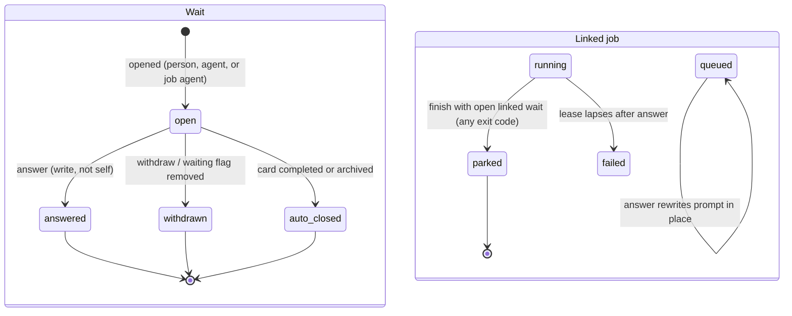
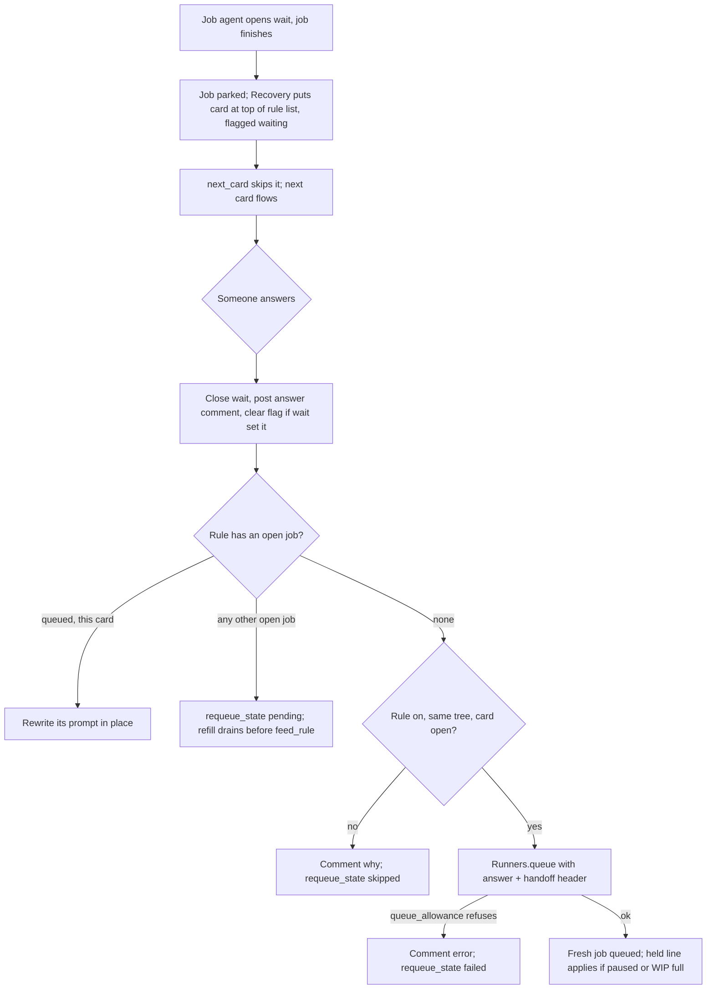
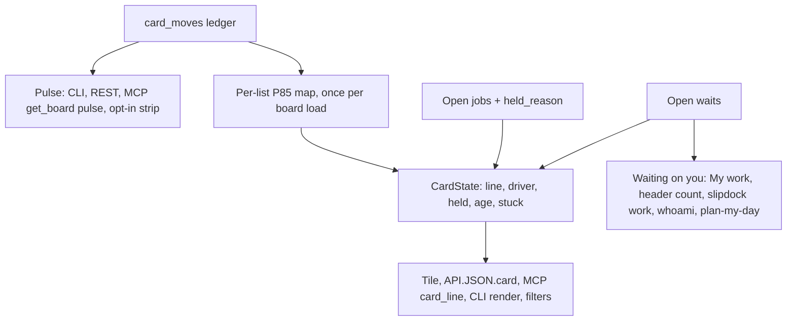

# Agent Supervision - Plan

## Goal Capsule

- **Objective:** Someone supervising a Slipdock board where agents do most of the work can see, at a glance and from the CLI or MCP, what is waiting on them, what is stuck, what an agent is doing and why work is held. When an agent needs an answer, the answer gets the work going again. Boards without agents gain nothing they have to ignore.
- **Means:** Six features built from ideas 1–6 of `docs/ideation/2026-10-19-lua-fleet-flow-ideation.html`. A movement ledger and board pulse come first (KTD1, KTD3). They are followed by wait records with parked jobs and re-queue on answer (KTD4–KTD8), a "Waiting on you" section, pause and held-because lines (KTD10–KTD12), and one derived card state line (KTD13).
- **Authority:** Product behavior is owned by the R-IDs below. Implementation mechanism is owned by the KTDs. Units cite both and override neither. Project rules in `CLAUDE.md` (CLI parity, agents page, skills, README, tests in the same commit) apply to every unit.
- **Stop conditions:**
  - Stop and ask if a unit needs to change the runner claim protocol in a way that breaks existing shell runners. Old runners must keep working (R27).
  - Stop and ask if a unit has to grow the short API guide past its 22,000-byte cap.
  - Stop and ask if a unit needs a new MCP tool. The plan keeps the count at 52.
- **Execution profile:** Deep, nine units: three phases covering U1–U8, then a closing docs unit U9, with database migrations and backfill. Each unit lands as its own commit with its tests and a green suite.
- **Finishes and ships:** the implementing agent, unit by unit on `main`, following the repo's commit/push practice and the CI checks in the Verification Contract.

---

## Product Contract

### Summary

The plan has three phases:
- Record every card move with who made it, and derive board flow numbers from that record. The numbers come first through the CLI and MCP, with an opt-in plain-words strip on the board.
- Give "waiting on a person" a real record with a question, an owner and a clock. Answering it starts a fresh agent job with the answer at the top of its prompt.
- Add three things supervisors read: a "Waiting on you" section in My work with a header count; a pause with a reason and a "held because" line; and one state line per card, with an age chip that turns amber past the list's usual time.

### Problem Frame

Slipdock already runs agents against boards through runners, list_top rules and the slipdock skills. Supervising them is blind in four ways:
- **Agents dead-end.** The unattended job prompt tells an agent to "comment, flag the card waiting and stop" (`lib/slipdock/automations/runner.ex:287-290`). Nothing brings the work back when a person replies.
- **No timestamps.** The `waiting`, `review` and `blocked` flags record no time and no owner (`lib/slipdock/boards/card.ex:6`). Moves are logged as free text with no source list (`lib/slipdock/boards.ex:2175`). So the board cannot say how long anything has waited or sat in a list.
- **Signals are scattered.** What needs a person is spread across flags, recovery comments, failed jobs and the alert bell. My work only sorts by due date.
- **No brake.** Stopping runaway automation means disabling rules one at a time. WIP limits are display-only. A runner job's state is visible only inside the card modal.

The trigger was a screenshot of Lua's "fleet-flow" board, which shows these signals for a developer-only fleet. Slipdock has to deliver them on its generic card model, so a chores or ops board benefits and nothing developer-specific appears where no agents run.

### Requirements

**Movement history and pulse**
- R1. Every change of a card's list is recorded with source list, destination list, both categories, time and actor, exactly once per move, including cross-board moves. Card creation, archive and restore are recorded too. Stand-ins are not.
- R2. Each record classifies its actor as human, agent or automation, and keeps how the change arrived (web, CLI, MCP, API, runner, assistant, automation) and the agent's token label when there is one.
- R3. Existing history is recovered from the activity log where it can be parsed unambiguously; recovered rows are marked as backfilled and carry no actor kind.
- R4. A board pulse reports: cards in progress, cards waiting on a person (with the oldest wait), cards done in the last 7 days (with today's count), P50/P85 time to done, moves in the last 24 hours forward and back, and per-list in/out counts over 7 days.
- R5. The pulse is available from the CLI, REST and MCP on every board, and as a plain-words strip on the board page only when the board owner turns it on (off by default).

**Waiting on a person**
- R6. A person or an agent can open a wait on a card. It states what is needed, who it waits on (a named person or anyone), when it was opened and, optionally, a short list of answer choices. A card has at most one open wait.
- R7. An open wait sets the card's `waiting` flag. Removing that flag by hand withdraws the wait. Closing the wait clears the flag only if the wait set it.
- R8. Anyone with write access can answer an open wait, from the card, from My work, from the CLI, from REST or from MCP. An agent cannot answer a wait it opened itself. A person can always answer or withdraw their own. The answer is posted on the card as a comment attributed to whoever answered.
- R9. When a runner job asked the question, answering it queues one fresh job for the same rule, with the answer and the latest handoff at the top of its prompt. Waits not opened from a job just close.
- R10. A job agent can park its job on a question in one step, whether it runs under a session runner (MCP/REST) or a shell runner (the agent opening a wait from inside the job). A parked job never comes back on its own.
- R11. While a question is unanswered, the rest of the rule's list keeps flowing. One parked card does not hold up the next card.
- R12. If the answer cannot start a job (the rule was turned off or deleted, the card moved to another board tree, the card was completed, or the queue refused), the card says so in a comment, and the wait records why. Nothing fails silently.
- R13. Completing or archiving a card closes its open wait with that reason. Deleting a card removes it.

**Waiting on you**
- R14. My work opens with a "Waiting on you" section, oldest first, each item with its reason and how long it has waited. It covers: open waits on you; open waits on anyone on cards you own or are assigned; cards assigned to you flagged `review` or `waiting`; cards the runner gave up on (flagged blocked by recovery) or whose newest job failed, on boards you own; and, for the root board owner only, cards in a doing list for over an hour with nobody on them ("needs owner").
- R15. The header shows the count of that section on every signed-in page, refreshed within 60 seconds of a change.
- R16. The same section is available from `slipdock work`, a REST endpoint, the `whoami` answer (as a count) and the plan-my-day prompt.

**Pause and held work**
- R17. A board owner can pause a board tree or one runner pool on it, with a required reason. While paused, no job is claimed and no list_top rule sends a card. Running jobs finish normally. Resuming wakes waiting runners and rules at once.
- R18. A banner on the paused board names who paused it, when and why. `get_board`, `list_cards` and the CLI answers carry the pause, so agents working without a pool can see it and stop.
- R19. A board owner can opt in to WIP limits holding automated work. A job or list_top send whose card is not already in progress is held while the board's first in-progress list is at or over its limit. People moving cards still only see the warning badge.
- R20. A held job or card states one reason: paused (by whom, why), WIP full (which list, n/n), waiting on another card in progress, or no runner online for its pool. The same line appears in claim answers, the card's jobs section and the card state line.

**Card state and age**
- R21. Every card has one derived state line built from its open job, open wait, flags, handoff and assignee, for example "Running · runner-2 · 7m" or "Waiting on Dana · 41m". It is shown on the tile, returned by REST, MCP and the CLI, and omitted when there is nothing to say.
- R22. A tile shows a small agent or person mark when an agent job holds the card. An All / Agent / Human filter on the board, REST, MCP and CLI uses the same classification. Neither appears on a board tree with no runner rules.
- R23. A card's age chip shows how long it has been in its current list. It turns amber, with how far over, when that exceeds the list's usual time (its 85th-percentile stay). It shows no colour on done or dropped lists, on cards with an open wait, or where history is too thin.
- R24. "Stuck" (over the list's usual time) is a filter on the board, REST, MCP and the CLI.

**Agent and document parity**
- R25. Every feature above is reachable without the UI, through the REST API, MCP and the `slipdock` CLI, without adding an MCP tool.
- R26. The runner prompt, the slipdock skills (both copies), the agents page, `docs/agents.md`, `docs/manual.md`, the README and the API guide describe waits, pauses and the new fields. The short guide stays under its byte cap.
- R27. Existing runners, rules and boards keep working unchanged. A board that never uses runners, waits or the strip looks as it does today, apart from the age chip and the Waiting-on-you section, which apply to everyone.

### Key Decisions

- **Ideas 1–6 of the fleet-flow ideation, without idea 7 (summary tiles for big and quiet lists).** (session-settled: user-directed — chosen over planning all seven ideas: the user named ideas 1 to 6 inclusive.) Governs R1–R27.
- **Answering restarts with a fresh job, not a suspended session.** Keeping a live agent session waiting for hours is fragile and costs a lease. Governs R9, R10.
- **One parked question must not freeze its rule's list.** A parked card goes back to the top of its list, flagged waiting, so the next card can run. Governs R11.
- **WIP limits hold only automated work, and only on opt-in.** Blocking people's drags is contested. Governs R19.
- **The stats strip is opt-in, but the numbers reach agents everywhere.** Governs R5.
- **The state line is display-only; it does not lock a card against people.** Governs R21.

### Acceptance Examples

- AE1. Covers R9, R10, R11.
  - **Given:** a list_top rule with a shell runner.
  - **When:** the agent on card A runs `slipdock wait A "Which region?" --choice eu --choice us` and exits 0.
  - **Then:** the job ends `parked`. Card A returns to the top of the rule's list flagged waiting, and the next card B is sent and claimed.
  - **And then:** when Dana answers "eu" on card A, exactly one new job for the rule is queued for card A, and its prompt begins with the question, Dana's answer and the handoff.
- AE2. Covers R9, R10.
  - **Given:** a running job whose agent opened a wait, which Dana then answered.
  - **When:** the job's lease lapses with attempts left.
  - **Then:** the old job does not return to the queue with its old prompt. One fresh job with the answer is queued once the old one is closed.
- AE3. Covers R12.
  - **Given:** a parked card whose rule was turned off.
  - **When:** the wait is answered.
  - **Then:** the wait closes, the answer is posted, and a second comment says the rule is off and nothing was sent.
- AE4. Covers R7.
  - **Given:** a card with an open wait.
  - **When:** someone removes the `waiting` flag in the UI.
  - **Then:** the wait closes as withdrawn, with a comment naming who removed it, and no job is queued.
- AE5. Covers R17, R20.
  - **Given:** pool `dev` is paused with reason "bad deploy".
  - **When:** a runner in `dev` claims.
  - **Then:** it receives no job, and the claim answer reads "paused by David: bad deploy". A running job's `job_progress` still answers `ok`.
- AE6. Covers R19.
  - **Given:** automation WIP is on and the first in-progress list is at 3/3.
  - **When:** a list_top rule would send its top card.
  - **Then:** the card is held with "WIP full: In Progress 3/3". A person can still drag a fourth card in and sees the red badge.
- AE7. Covers R23.
  - **Given:** In Review's 85th-percentile stay is 2h, from 12 closed stays in the last 90 days.
  - **When:** a card has been in In Review for 3h.
  - **Then:** its chip reads "In Review 3h · 1h over usual" in amber. On a list with only 5 closed stays and no board-wide figure for its category, the chip shows plain age with no colour.

### Scope Boundaries

- Not built: summary tiles for big and quiet lists, persisted swimlane collapse, Lua-style top tabs, mapping stages to another tracker, live PR/CI status on links (ideation, rejected or not chosen).
- Not built: an escalation clock that raises alerts when a wait goes unanswered, and a circuit breaker that pauses a pool after repeated failures. Both are optional follow-ons in the ideation. Revisit once waits and pause have been used.
- Not built: answering a wait by replying to an email. The repo has no inbound mail. Evidence that would change this is a request for email answers once waits exist.
- Not built: a hard refusal of agents' direct moves into doing while paused. Pause is enforced on claims and list_top sends. Agents working without a pool see the pause on `get_board` and `list_cards`, and the skills stop on it. Revisit if agents are seen ignoring it.
- Not built: a cap on how many questions an agent may ask on one card. The wait panel shows the count instead. Humans answering is the natural limit.
- Not built: a `my_work` MCP read tool. `whoami` carries the count and the plan-my-day prompt carries the list.
- Not built: a per-user push topic for the header count. The 60s refresh meets R15, and push would add broadcast points in three units. Revisit if a minute's lag proves annoying.

#### Deferred to Follow-Up Work

- Structured moves in the MCP `activity` tool (per-card ledger rows over MCP).
- A per-rule "into" list for WIP, for boards with several in-progress lists.

---

## Planning Contract

### Key Technical Decisions

- KTD1. **A `card_moves` table, written at the two move choke points.**
  - Where it is written: inside `Boards.do_move_card/3` and `Boards.do_move_card_to_board/2`, before `automate/1` runs, so rules that move the card again are recorded in order. Also written by `create_card`, import, copy-to-list, `archive_card` and `unarchive_card`, as event kinds `created`, `moved`, `archived` and `restored`.
  - Each row snapshots the list names and categories, so renames and deletions don't break history. Column ids are nilified on delete.
  - Stand-ins keep their bypass via `reorder/4` and never get rows.
  - `Card.changeset` stops casting `:column_id`, so nothing can move a card around the ledger.
  - This is a new table rather than columns on `activities`, because activities are free text read by the narrative and the backfill, and the pulse needs indexed `(board_id, inserted_at)` and `(card_id, inserted_at)` scans.
- KTD2. **The actor is passed in, with a fallback.**
  - `move_card/4`, `move_card_to_index/4` and `move_card_to_board/3` take `opts` with `:by`, `:via`, `:agent` and `:job_id`, mirroring `update_card`'s `opts[:by]`. Every caller listed in research passes its actor.
  - When nothing is passed, the fallback is `automation` if `Process.get(:automation_depth)` is set, else unknown.
  - Classification:
    - web UI → human
    - CLI → human, unless it sends `x-slipdock-agent` → agent
    - MCP → agent
    - REST with a token and no CLI header → agent
    - runner/job → agent
    - in-app assistant → agent
    - rules, Recovery, snooze wake, gardener steps → automation
  - The CLI sends `x-slipdock-agent` (and the job id) when `CLAUDECODE` or `SLIPDOCK_JOB_ID` is set. The skills drive the board through the CLI, so "CLI = human" would misfile most agent moves.
- KTD3. **The pulse is computed in Postgres from the ledger and `completed_at`.**
  - "Done" counts come from `completed_at`. A card completed by checkbox never enters a done list, so this is the only complete source.
  - "Time to done" is cycle time: first entry into a doing-category list → `completed_at`. It falls back to lead time from `cards.inserted_at`, labelled, when there is no doing entry (backfilled cards).
  - Percentiles use `percentile_cont`.
  - A list's usual stay is the P85 of its closed stays in the last 90 days, used only with at least 8 of them. Below that it falls back to the board-wide P85 for the list's category, and otherwise no colour.
  - The per-list P85 map is computed once per `load_board` (one aggregate query) and passed to tiles. It is not computed per card.
  - When a card's latest ledger row does not end in its current list (a move the backfill could not parse), its time in the list is unknown. It shows no age colour, and that stay is excluded from the P85.
  - A backfilled stay ends at the next parsed row only when that row's source matches the stay's list.
- KTD4. **A `card_waits` table with one open wait per card.**
  - A partial unique index on `card_id WHERE closed_at IS NULL` enforces one open wait per card. A second open is refused with the existing wait named.
  - Fields:
    - the question: `needs`, `on_user_id` (nil = anyone), `choices`
    - who opened it: `opened_by_id`, `via`, `agent`, `job_id`
    - the flag: `set_flag`
    - closure: `closed_at`, `closed_by_id`, `close_reason` (answered | withdrawn | card_completed | archived)
    - the answer: `answer`, `choice`
    - re-queue: `requeue_state` (none | queued | pending | failed | skipped) and `requeue_note`
  - Closing is a conditional update on `closed_at IS NULL`, so the losing racer gets "already answered by X at T".
  - Linking to a job:
    - An explicit `job_id` is accepted only when it names a claimed or running job on the same card. Anything else refuses the open, so no caller can park another card's job.
    - A wait opened over MCP or REST with a token that belongs to a session runner whose current job is on the same card links to that job automatically, unless the request names a `job_id`. Old session runners therefore park through `update_card wait` alone.
    - Imported waits arrive with `job_id` nil, like imported handoffs.
  - It is modelled on the handoff stack (`lib/slipdock/boards/handoff.ex` and its 16 layers). The difference is that waits have a lifecycle where handoffs are append-only.
- KTD5. **A new terminal job status, `parked`.**
  - `Runners.finish/3` sets `parked` whenever the job has an open linked wait, whatever the exit code. A shell runner's agent links the wait through `$SLIPDOCK_JOB_ID`.
  - An explicit `status: parked` from a runner whose job has no linked wait is refused.
  - `finish_job outcome:"waiting"` with a `wait` object opens the wait and parks the job in one transaction. If the runner no longer holds the job, neither happens.
  - `expire/2` never puts a job with an open or answered linked wait back in the queue. An open wait parks it; an answered one fails it with a pointer to the fresh job.
  - `parked` joins `Job.finished_statuses`, `Spec.job_outcomes`, `job_counts`, the RunnersLive filters and the CLI `jobs` output. The open-job partial unique index already excludes it.
- KTD6. **Recovery puts a parked card back without spending a retry.**
  - For every list_top rule, whatever its `requeue_stuck` value, a parked job's card goes back to the top of the rule's trigger list, flagged waiting. The job is marked `recovery: "parked"`.
  - This is a branch of `Recovery.recover/1` that runs before its `requeue_limit(rule) > 0` gate, because that gate is 0 for rules saved with `requeue_stuck` 0.
  - `requeued/2` counts only `recovery == "requeued"`, so parks never use up retries.
  - `next_card` already skips `waiting` cards, so the next card flows.
  - Event-triggered rules don't feed a list, so their parked card stays where it is.
  - The alternative was leaving the card in doing and exempting open waits from `busy_cards`. It was rejected because it breaks the one-card-at-a-time working-tree guarantee that `wait_while_doing` exists for.
- KTD7. **The answer re-queues directly through `Runners.queue/2`.**
  - It re-renders the rule's runner action with a header (question, answer or choice, answered by, then the current handoff) prepended. The handoff is truncated first and then the answer, with a pointer to the card, to stay under `@max_prompt`.
  - It does not go through `feed`, because `cooling_cards` (600s) and "top of list" don't apply to an answered card.
  - The close, the flag clear and the queue run inside the rule's `{:feeding, rule.id}` guard (the `Recovery.quietly/2` pattern), so the flag-removed event cannot feed the rule first.
  - If the rule still has an open job for this card, a still-queued job has its prompt rewritten in place.
  - Otherwise, a list_top rule keeps at most one open job. If the rule has any open job (for this card or another), the wait gets `requeue_state: pending`. `Runners.refill/1` drains pending re-queues before it calls `feed_rule`.
  - Event-triggered rules queue at once unless their job for this card is still open, in which case the same `pending` path applies.
  - If the rule is disabled or deleted, the card has changed tree or the card is completed, the state is `skipped`. If `queue_allowance` refuses, the state is `failed`. Both post a comment.
- KTD8. **Permissions.**
  - Opening a wait needs write permission, because it sets the `waiting` flag and can park a job. A comment-level member changes no flags today (`lib/slipdock/access.ex`).
  - Answering needs write permission, because the answer becomes prompt text for an agent.
  - The self-answer refusal applies only when both the opener and the answerer are classified as agent and share a token or job. A human-classified request can always answer: the web UI, or the CLI without the agent header, even on the same token.
  - Withdrawing needs write permission or being the opener.
- KTD9. **No new MCP tools.** Existing tools are extended:
  - `finish_job` gains `outcome: "waiting"` plus `wait`.
  - `update_card` gains `wait` (open), `wait: null` (withdraw) and `answer_wait`.
  - `get_card` returns `wait` and `last_wait`.
  - `claim_job` and the REST claim return `wait` and `handoff` alongside the prompt.
  - `get_board` gains `pulse: true` and always carries `paused`.
  - `list_cards` gains `stuck` and `driver` filters and carries `paused`.
  - `manage_automation` gains `pause` and `resume`.
  - New behaviour is described in property descriptions, to stay inside the description-length tests.
- KTD10. **A `runner_pauses` table keyed on the root board.**
  - A pool is only a string, so there is no entity to flag.
  - Fields: `root_board_id`, nullable `pool` (nil = whole tree), required `reason`, `paused_by_id`, `inserted_at`, `resumed_at`, `resumed_by_id`.
  - Enforced in `Runners.try_claim/1` as a `not exists` subquery modelled on `busy_cards/0`, and in `Automations.feed/2`'s `cond` as `{:idle, :paused}`.
  - Jobs still queue while paused. Event-triggered runner actions hold and then release on resume.
  - Resume runs `feed_board` for every board in the tree and broadcasts `:job_queued` on every pool topic for the root.
- KTD11. **Automation WIP as a board boolean, `automation_wip`, following the `simple` column pattern.**
  - The check: the card is not in a doing-category list, and the board's first doing-category list by position has a `wip_limit` and a count (same rule as the badge: active cards, no stand-ins) at or over it.
  - Checked in `feed/2` and in `try_claim/1`. Cards with open waits count toward the limit.
- KTD12. **One held reason.** `Runners.held_reason/1` generalises `waiting_on/1`, `waiting_reason/1` and `first_waiting/2`, in priority order: paused, then WIP full, then waiting on #N in progress, then no runner online. "Online" means `last_seen_at` within three lease periods. The three claim endpoints, the card jobs section and the state line all read it. The "no runner online" reason is never shown to the claimant itself.
- KTD13. **One `Slipdock.CardState` module derives each card's state.**
  - It produces `line`, `driver` (agent | human | nil), `held`, `age`, `in_list_since`, `over_usual` and `stuck`.
  - Its inputs are batch-loaded per board: open jobs per card, open waits, the latest ledger entry per card, and the P85 map.
  - It is decorated onto cards in a `put_*` step of `Boards.load_board/1`, like `current_handoffs/1`. `API.JSON.card/1`, `MCP.Tools.card_line/1` and the CLI render read the same values.
  - Keys are added only when non-nil. `driver` and the agent mark are computed only when the tree has a runner rule or the card has a job.
- KTD14. **The header count comes from `AlertsHook`.**
  - The hook assigns `waiting_count`. `Layouts.app` gains a `waiting_count` attr, passed at each of the 29 call sites that already pass `alerts={@alerts}`, so every page shows it consistently.
  - Freshness: a 60s timer in the hook recomputes the count, which meets R15. The hook also recomputes on mount and after the user's own wait actions in the same LiveView. A per-user push topic is not built (see Scope Boundaries).
- KTD15. **The stats strip is a board boolean, `show_pulse`, default false.** Pulse data is computed only when it is on or explicitly requested.
- KTD16. **The short API guide stays byte-neutral.** Edits to its core sections (`mcp`, `working`, `choosing`) are offset by trimming elsewhere. Detail goes into the full guide and the non-core `runners` section. `test/slipdock_web/mcp/read_tools_test.exs` runs after every `api_guide.ex` edit.

### High-Level Technical Design

Wait and job lifecycle (R6–R13; KTD4–KTD7):

Answer to fresh job (R9, R11, R12; KTD6, KTD7):

Derived data flow (R1–R5, R14, R20–R24; KTD1, KTD3, KTD12, KTD13):

### Assumptions

None beyond the KTDs above. The scoping synthesis was confirmed interactively.

### Sequencing

Phase A (U1 → U2 → U3) lays the data foundation. Phase B (U4 → U5) builds waits and parked jobs. Phase C (U6, U7, U8) reads from both. U6 must land before U9 rewrites the skills, because the skills' fallback to the ready list has to learn to stop on a pause. U9 closes with the docs and skills sweep.

---

## Implementation Units

### U1. Actor plumbing and classification

- **Goal:** Every card move knows who made it and through which door, so the ledger and the Agent/Human split are trustworthy.
- **Requirements:** R2, R25, R27.
- **Dependencies:** none.
- **Files:**
  - `lib/slipdock/boards.ex`
  - `lib/slipdock/boards/card.ex`
  - `lib/slipdock/actor.ex` (new: classification helper)
  - `lib/slipdock_web/user_auth.ex`
  - `lib/slipdock_web/mcp/plug.ex`
  - `lib/slipdock_web/controllers/api/card_controller.ex`
  - `lib/slipdock_web/controllers/api/card_writes.ex`
  - `lib/slipdock_web/mcp/tools/move_card.ex`
  - `lib/slipdock_web/live/board_live/show.ex`, `keyboard.ex`, `card_component.ex`, `state.ex`, `move_board_component.ex`, `snooze_events.ex`
  - `lib/slipdock/snooze.ex`, `lib/slipdock/bulk_edit.ex`, `lib/slipdock/sprints.ex`, `lib/slipdock/ai/actions.ex`, `lib/slipdock/gardener/steps.ex`, `lib/slipdock/automations/runner.ex`, `lib/slipdock/runners/recovery.ex`
  - `cli/lib/slipdock_cli/http.ex`
  - Tests: `test/slipdock/actor_test.exs`, `test/slipdock_web/actor_api_test.exs`, `cli/test/agent_header_test.exs`
- **Approach:**
  1. Add the `opts` argument to the three move entry points per KTD2, and thread it to both choke points.
  2. Build the actor from conn assigns (`current_user`, `api_token`, `x-slipdock-client`, new `x-slipdock-agent`) and from the MCP `tool_context`. Return a small map: kind, via, user, agent label, job id.
  3. Update each caller to pass its actor. Rules, Recovery, snooze wake and gardener pass `automation` explicitly.
  4. Drop `:column_id` from `Card.changeset`'s cast (research found no caller relies on it).
  5. In the CLI, send `x-slipdock-agent: 1` and `x-slipdock-job` when `CLAUDECODE` or `SLIPDOCK_JOB_ID` is set.
- **Patterns to follow:**
  - `update_card/3`'s `opts[:by]`.
  - Wiki revisions' `via` and `agent` (`lib/slipdock_web/controllers/api/page_controller.ex:1681-1693`, `lib/slipdock_web/mcp/tools/update_page.ex:350`).
- **Test scenarios:**
  - A web UI drag records kind human, via web and the user.
  - An MCP `move_card` records kind agent, via mcp and the token label.
  - A REST move with a token and no CLI header records agent. With `x-slipdock-client: cli` and no agent header it records human. With both headers it records agent with the job id.
  - A list_top rule's `move_card` action records automation without the caller passing anything (the process-dict fallback).
  - Recovery's requeue move records automation.
  - `update_card(card, %{"column_id" => other})` leaves the card's list unchanged.
  - The CLI sends the agent header when `CLAUDECODE=1`, sends both headers when `SLIPDOCK_JOB_ID=42`, and sends neither when both are unset.
- **Verification:** every move path in research section 2 passes an actor, and no compile warnings remain from changed arities.

### U2. Movement ledger and backfill

- **Goal:** A complete, ordered record of list changes per card that every flow feature reads.
- **Requirements:** R1, R2, R3.
- **Dependencies:** U1.
- **Files:**
  - `priv/repo/migrations/<next>_create_card_moves.exs`
  - `lib/slipdock/boards/card_move.ex` (new)
  - `lib/slipdock/boards.ex`
  - `lib/slipdock/portable/import.ex`, `lib/slipdock/boards/copy.ex`
  - Tests: `test/slipdock/card_moves_test.exs`, `test/slipdock/card_moves_backfill_test.exs`
- **Approach:**
  1. Write the table and indexes per KTD1.
  2. Insert rows in `do_move_card/3`, inside `unless same_column?` and before `automate`. Insert in the `do_move_card_to_board/2` transaction, with both boards on the row.
  3. Write `created` in `create_card`, import and copy. Write `archived` and `restored` in archive and unarchive.
  4. The backfill runs as SQL in the migration's `up`:
     - Parse `moved “…” to <list>` using the text after the last `” to `, matched against the board's current list names.
     - Skip lists whose names are duplicated or don't match.
     - Take the source list from the previous parsed row, and the cross-board source from the destination's `in from` line.
     - Seed a `created` row from `cards.inserted_at` and the card's first parsed list, or its current list when none parse.
     - Mark every recovered row `backfilled`, with a nil actor kind.
  5. Add `Boards.list_entered_at/1` (card → latest entry time), batched for a board.
- **Execution note:** Write the backfill test against a seeded activity log before writing the SQL.
- **Patterns to follow:**
  - `priv/repo/migrations/20261004160000_add_completed_at_to_cards.exs` (SQL backfill in `up`, column drop in `down`).
  - `priv/repo/migrations/20261018003000_create_card_handoffs.exs` (card-attached table and indexes).
- **Test scenarios:**
  - Moving To Do → Doing writes one row with both list ids, names, categories and the actor. A same-list reorder writes none.
  - A rule fired by the move that moves the card on writes a second row after the first, in order.
  - A cross-board move writes one row carrying both boards. Subcards riding along write none.
  - `follow_stand_ins` moving a stand-in to done writes no row.
  - Creating, importing and copying a card each write a `created` row in its list.
  - Archive then unarchive writes `archived` then `restored`, and `list_entered_at` returns the restore time.
  - Renaming a list keeps old rows' snapshot names. Deleting a list nilifies the column ids but keeps the rows.
  - Backfill:
    - A card with activity "moved “Fix the to-do list” to Doing" (title contains `” to `) resolves to Doing.
    - A move to a since-renamed list is dropped.
    - Two lists with the same name are skipped.
    - All recovered rows are `backfilled` with a nil actor kind.
    - When a move into a renamed list is dropped, the stay before it does not stretch over the gap. It ends only at a row whose source is that stay's list.
- **Verification:** the migration runs up and down cleanly on a copy of real data. The backfill test asserts the row counts for a mixed fixture.

### U3. Board pulse and per-list usual stay

- **Goal:** Flow numbers for any board, first for agents and the CLI, then as an opt-in strip.
- **Requirements:** R4, R5, R25.
- **Dependencies:** U2.
- **Files:**
  - `lib/slipdock/pulse.ex` (new)
  - `priv/repo/migrations/<next>_add_show_pulse_to_boards.exs`
  - `lib/slipdock/boards/board.ex`
  - `lib/slipdock_web/live/board_live/settings_component.ex`
  - `lib/slipdock_web/live/board_live/board_view.ex`
  - `lib/slipdock_web/controllers/api/board_controller.ex`, `lib/slipdock_web/router.ex`, `lib/slipdock_web/controllers/api/json.ex`
  - `lib/slipdock_web/mcp/tools/get_board.ex`
  - `cli/lib/slipdock_cli/boards.ex`, `cli/lib/slipdock_cli/render.ex`, `cli/lib/slipdock_cli.ex`
  - Tests: `test/slipdock/pulse_test.exs`, `test/slipdock_web/pulse_api_test.exs`, `test/slipdock_web/live/pulse_live_test.exs`, `cli/test/pulse_test.exs`
- **Approach:**
  1. `Pulse.for_board/2` returns the R4 figures per KTD3. In-progress and waiting counts come from current state (doing-category lists; open waits once U4 lands, `waiting` flags until then).
  2. `Pulse.usual_stays/1` returns the per-list P85 map with the fallback chain. It is called once per `load_board`.
  3. Add the `show_pulse` board boolean (KTD15).
  4. Add `GET /api/boards/:board/pulse`, `get_board pulse: true` (returning the pulse instead of the lists) and `slipdock pulse <board>` with `--json`.
  5. Render the strip in plain words when `show_pulse` is on, for example "6 in progress · 2 waiting (oldest 41m) · 23 done this week · usually 1d to done".
- **Patterns to follow:**
  - Board booleans `simple` and `page_card_features` (`lib/slipdock/boards/board.ex`, the settings checkboxes in `settings_component.ex:500-545`).
  - Sprint charts, for view-only rendering (`lib/slipdock_web/components/sprint_chart_components.ex`).
- **Test scenarios:**
  - On a board with 10 cards completed across 7 days, `done_7d` is 10 and today's count matches.
  - A card completed by checkbox without moving counts as done.
  - Time to done uses first doing entry → `completed_at`. A card with no doing entry uses `inserted_at` and is flagged as lead time.
  - Moves in 24h split forward and back by list position (Doing → To Do counts as back).
  - Per-list in/out counts over 7 days include cross-board arrivals on the destination board.
  - Usual stay:
    - A list with 8 closed stays gets its own P85.
    - With 7 it falls back to the category P85.
    - With no category figure it returns nil.
    - Open stays are excluded.
  - REST pulse, MCP `get_board pulse:true` and `slipdock pulse` return the same numbers for one board.
  - The strip is absent by default, appears after the owner ticks the setting, and a non-owner cannot change the setting.
  - A board with no cards returns zeros and nil percentiles, with no error.
- **Verification:** `load_board` runs one extra aggregate query for usual stays, and the pulse does not run unless requested or the strip is on.

### U4. Wait records

- **Goal:** A typed, timestamped "waiting on a person" with an owner and an answer path, on every surface.
- **Requirements:** R6, R7, R8, R12, R13, R25.
- **Dependencies:** U1 (actor for opener and answerer).
- **Files:**
  - `priv/repo/migrations/<next>_create_card_waits.exs`
  - `lib/slipdock/boards/wait.ex` (new)
  - `lib/slipdock/boards/card.ex`, `lib/slipdock/boards.ex`
  - `lib/slipdock_web/controllers/api/card_writes.ex`, `card_controller.ex`, `json.ex`, `lib/slipdock_web/router.ex`
  - `lib/slipdock_web/mcp/tools/update_card.ex`, `get_card.ex`, `lib/slipdock_web/mcp/resources/render.ex`, `lib/slipdock_web/mcp/prompts/context.ex`
  - `lib/slipdock_web/live/board_live/card_component.ex`, `card_panel.ex`, `lib/slipdock_web/components/slipdock_components.ex`
  - `lib/slipdock/portable/export.ex`, `import.ex`, `lib/slipdock/account_export.ex`
  - `cli/lib/slipdock_cli/boards.ex`, `render.ex`, `cli/lib/slipdock_cli.ex`
  - Tests: `test/slipdock/waits_test.exs`, `test/slipdock_web/wait_api_test.exs`, `test/slipdock_web/mcp/wait_tools_test.exs`, `test/slipdock_web/live/wait_live_test.exs`, `cli/test/wait_test.exs`
- **Approach:**
  1. Schema and context per KTD4: `open_wait/3`, `answer_wait/3`, `withdraw_wait/3`, `current_wait/1`, batch `current_waits/1`, `last_wait/1`.
  2. Each lifecycle step posts a comment and broadcasts on the card. Job links follow KTD4.
  3. Opening adds the `waiting` flag through `update_card` (so `flag_added` rules fire) and records `set_flag`.
  4. The flag hook in `update_card`: removing `waiting` while a wait is open withdraws it (R7, AE4).
  5. `apply_column_semantics` completion and `archive_card` auto-close with their reasons (R13).
  6. Re-queue is a no-op hook here. U5 fills it.
  7. Surfaces:
     - REST: `POST /cards/:id/wait`, `DELETE /cards/:id/wait`, `POST /cards/:id/wait/answer`.
     - MCP: `update_card` gains `wait`, `wait: null` and `answer_wait`. `get_card` returns `wait` and `last_wait`.
     - CLI: `slipdock wait <card> "needs" [--on EMAIL] [--choice X]... [--job ID]`, which reads `$SLIPDOCK_JOB_ID` by default. Also `slipdock answer <card> "text" | --choice N`, and `slipdock wait <card> --withdraw`.
     - Card modal: a wait panel with answer buttons for the choices, a free-text box, and how many questions have been asked on the card. The tile shows the reason (until U7 replaces it with the state line).
     - Export and import carry waits, with `job_id` dropped on import (KTD4).
  8. Permissions per KTD8.
- **Patterns to follow:**
  - The handoff stack: `lib/slipdock/boards/handoff.ex`, `Boards.leave_handoff/3`, `card_writes.ex` `write_handoff/4`, `leave_handoff.ex`, `cli/lib/slipdock_cli/boards.ex` `run("handoff", …)`, `handoff_panel/1`, and its tests listed in research section 5.
- **Test scenarios:**
  - Opening:
    - Opening a wait sets `waiting`, records the opener's kind, via and label, and comments "Waiting on Dana: Which region?".
    - A second open on the same card is refused, naming the open wait.
  - Answering:
    - Dana answers with free text. The wait closes as answered, the answer comment is attributed to Dana and the flag clears.
    - When the flag was already set before the wait opened (`set_flag` false), answering leaves the flag on.
    - Answering with `choice: 2` stores the choice and comments its text. Free text alongside choices is allowed.
    - Two answers race: one wins, and the other gets "already answered by X at T".
    - An agent-classified request answering a wait it opened is refused.
    - The same CLI token without the agent header answers successfully, because the person and the agent share it.
    - A person answering or withdrawing their own wait succeeds.
    - A comment-only member cannot open a wait or answer one, over REST, MCP or the CLI.
  - Job links:
    - A `job_id` naming another card's job, or a finished job, refuses the open and leaves that job untouched.
    - A wait opened over MCP by a session runner's token whose current job is on this card links to that job without a `job_id`.
  - Closing without an answer:
    - Covers AE4. Removing `waiting` via the UI, REST `remove_flags` or MCP withdraws the wait and comments who did it.
    - Completing the card (checkbox, or a move into a done list) closes the wait as `card_completed`. Archiving closes it as `archived`. Unarchiving does not reopen it. Deleting the card removes it.
  - Surfaces:
    - REST, MCP and CLI produce identical wait records for the same input. `get_card` returns `wait` while open and `last_wait` after.
    - The CLI `wait` uses `$SLIPDOCK_JOB_ID` when set and sends no job when unset. `answer --choice 1` posts choice 1.
    - The card modal shows the wait with choice buttons, and clicking one answers it (also covered in browser E2E).
  - Export and import round-trip open and closed waits, and imported waits have no `job_id`.
- **Verification:** the waits suite and the handoff suites are green. No board without waits changes its rendering.

### U5. Parked jobs and re-queue on answer

- **Goal:** An agent that asks a question parks cleanly, the rest of the list keeps moving, and the answer starts the work again.
- **Requirements:** R9, R10, R11, R12, R25, R27.
- **Dependencies:** U4.
- **Files:**
  - `lib/slipdock/runners/job.ex`, `lib/slipdock/runners.ex`, `lib/slipdock/runners/recovery.ex`
  - `lib/slipdock/automations.ex`, `lib/slipdock/automations/runner.ex`, `lib/slipdock/automations/spec.ex`
  - `lib/slipdock/boards.ex` (the answer hook)
  - `lib/slipdock_web/mcp/tools/finish_job.ex`, `claim_job.ex`
  - `lib/slipdock_web/controllers/api/job_controller.ex`, `runner_controller.ex`
  - `lib/slipdock_web/live/board_live/runners_component.ex`, `card_sections.ex`
  - `cli/lib/slipdock_cli/runners.ex`
  - Tests: `test/slipdock/runners/parked_test.exs`, `test/slipdock/runners/answer_requeue_test.exs`, `test/slipdock_web/mcp/job_tools_test.exs`, `cli/test/jobs_test.exs`
- **Approach:**
  1. Add `parked` per KTD5. Change `finish/3` to park on an open linked wait and to refuse a bare `parked`.
  2. Add `outcome: "waiting"` plus `wait` to `finish_job` and the REST finish, as one transaction.
  3. Change `expire/2` per KTD5.
  4. Recovery's parked branch per KTD6, ahead of the `requeue_limit` gate.
  5. The answer hook per KTD7: rewrite in place, `pending` while the rule has any open job (drained in `refill/1` before `feed_rule`), `skipped` or `failed` with comments. Build the prompt header from the rule's runner action. Truncate it to stay under `@max_prompt`.
  6. Claim answers (MCP, session REST, runner REST) carry structured `wait` and `handoff` beside `prompt`. Old runners only read `prompt` (R27).
  7. Rewrite `@unattended` to "If you need something only a person can give, open a wait (`slipdock wait <card> …` or update_card `wait`), say what you need, and stop."
- **Execution note:** Start with failing integration tests for AE1 and AE2. They cross runners, recovery, automations and boards.
- **Patterns to follow:**
  - `Runners.finish/3` and `runners.ex:655-700` (handoff from the job summary).
  - The `Recovery.requeue`/`give_up` structure.
  - The existing list_top tests in `test/slipdock/runners/recovery_test.exs`.
- **Test scenarios:**
  - Parking:
    - Covers AE1. A shell-runner job whose agent opened a wait with `--job` exits 0 and ends `parked`. The card returns to the top of the rule's list flagged waiting. The next card is sent and claimed.
    - MCP `finish_job outcome:"waiting"` opens the wait and parks the job together. Calling it after the lease lapsed returns an error and opens no wait.
    - `finish(status: "parked")` from a runner with no linked wait is refused.
    - A parked job's put-back does not count toward `requeue_stuck`. Three parks in a row never flag the card blocked.
    - On a list_top rule with `requeue_stuck` 0 and `wait_while_doing`, parking card A still puts it back, and card B is sent and claimed.
    - A session runner that calls `update_card wait` and then `finish_job` with a plain success outcome ends `parked`.
  - Answering:
    - Answering a parked wait queues exactly one job for the same rule and pool, whose prompt starts with the question, answer, answerer and handoff.
    - Covers AE2. The answer arrives while the job is running and the lease then lapses: the job fails with a pointer, not re-queued, and exactly one fresh job is queued after it closes.
    - The answer arrives while the job is still queued: that job's prompt is rewritten in place, and no second job is created.
    - Card A is answered while card B's job from the same list_top rule is running. The rule keeps one open job, and A's job is queued when B's closes, before the rule sends another card.
    - Clearing the flag on answer does not let the rule's feed send card A with its plain prompt first.
    - A prompt that would exceed `@max_prompt` truncates the handoff first, and the header names the card.
  - When the answer cannot start a job:
    - Covers AE3. With the rule disabled, the wait shows `skipped` and the card comments "rule … is off; nothing was sent". With the rule deleted, it shows `skipped` and makes no job from the old prompt.
    - With the card moved to another tree, it shows `skipped` with a comment. Moved to another board in the same tree, the job is queued.
    - When `queue_allowance` refuses (queue full), the wait shows `failed` with the error commented.
  - Claim answers:
    - MCP `claim_job` and REST claim return `wait` and `handoff` objects. A shell runner REST claim still returns a working `prompt` (R27).
    - A `job_finished` rule filtered on outcome `parked` fires, and the RunnersLive filter and the CLI `jobs` output show parked.
- **Verification:** the full runner and recovery suites stay green, and every new branch in the KTD7 decision has a test.

### U6. Pause, automation WIP and held reasons

- **Goal:** One brake with a reason, opt-in back-pressure, and one explanation wherever work is held.
- **Requirements:** R17, R18, R19, R20, R25.
- **Dependencies:** U1 (the actor for pause and resume).
- **Files:**
  - `priv/repo/migrations/<next>_create_runner_pauses.exs` (also adds the `automation_wip` board boolean)
  - `lib/slipdock/boards/board.ex`
  - `lib/slipdock/runners/pause.ex` (new)
  - `lib/slipdock/runners.ex`, `lib/slipdock/automations.ex`
  - `lib/slipdock_web/controllers/api/board_controller.ex` (or a new pause controller), `lib/slipdock_web/router.ex`, `lib/slipdock_web/controllers/api/json.ex`
  - `lib/slipdock_web/mcp/tools/manage_automation.ex`, `get_board.ex`, `list_cards.ex`, `claim_job.ex`
  - `lib/slipdock_web/live/board_live/board_view.ex`, `runners_component.ex`, `settings_component.ex`, `card_sections.ex`
  - `cli/lib/slipdock_cli/runners.ex`, `cli/lib/slipdock_cli.ex`
  - Tests: `test/slipdock/runners/pause_test.exs`, `test/slipdock/runners/automation_wip_test.exs`, `test/slipdock/runners/held_reason_test.exs`, `test/slipdock_web/pause_api_test.exs`, `test/slipdock_web/live/pause_live_test.exs`, `cli/test/pause_test.exs`
- **Approach:**
  1. Pause table and checks per KTD10. Owner-only, with an activity entry naming the actor and token label.
  2. Resume feeds every board in the tree and wakes every pool topic.
  3. Automation WIP per KTD11, in `feed/2` (`{:idle, :wip_full}`) and `try_claim/1`.
  4. `held_reason/1` per KTD12, replacing the three waiting helpers and used in all claim answers and the card jobs section.
  5. Surfaces:
     - REST `POST`/`DELETE /api/boards/:board/pause` (`pool`, `reason`).
     - MCP `manage_automation` `pause`/`resume`.
     - `get_board` and `list_cards` carry `paused`.
     - CLI `slipdock pause <board> [--pool P] --reason "…"` and `slipdock resume <board> [--pool P]`.
     - A Pause control for owners in the Runners panel: one for the whole tree in the panel header, and one on each pool row. Each opens a small form with a required reason, and the Pause button stays disabled until the reason is filled.
     - A banner on every board in the tree ("Paused on <root> by David: bad deploy · Resume"). Resume releases exactly the scope that was paused.
     - The settings checkbox for automation WIP.
- **Patterns to follow:**
  - `busy_cards/0` as a correlated `not exists`.
  - `ClaimDrain.draining?/0` for refusing claims.
  - `feed/2`'s `{:idle, :disabled}` branch.
  - `waiting_reason/1` for the held line.
- **Test scenarios:**
  - Pausing:
    - Covers AE5. A paused pool claim returns no job and the held line names who paused and why. `job_progress` for a running job returns `ok`. A list_top rule does not send while paused.
    - A whole-tree pause holds every pool. Resuming it while a pool pause remains leaves that pool held, and the line names the pool pause.
    - Resuming broadcasts on each pool topic, so a waiting long-poll claim returns a job without waiting for the clock. List_top rules on a sub-board send at once.
    - A non-owner's pause is refused over REST, MCP and CLI. A pause without a reason is refused.
    - Pausing from a sub-board stores it on the root, and the banner on a sibling board names the root.
  - Automation WIP:
    - Covers AE6. With automation WIP on and In Progress at 3/3, a list_top send is held with "WIP full: In Progress 3/3", a claim for a card in To Do is held, a claim for a card already in In Progress is not, and a person's drag succeeds.
    - With automation WIP off, nothing changes from today.
    - Stand-ins don't count toward the limit, and a card with an open wait does.
  - Held reasons:
    - "No runner online for pool dev" appears on the card when the only dev runner was last seen more than three leases ago, and never in that runner's own claim answer.
    - With several reasons at once, the highest-priority one is shown.
  - `get_board` and `list_cards` include `paused` while paused, and omit it when not.
- **Verification:** with no pauses and automation WIP off, existing claim and feed tests pass unchanged.

### U7. Card state line, age chip and filters

- **Goal:** Each tile says what is happening to the card, how long it has been in its list, and whether that is unusual. Agents get the same text.
- **Requirements:** R21, R22, R23, R24, R25, R27.
- **Dependencies:** U2, U3, U4, U5, U6.
- **Files:**
  - `lib/slipdock/card_state.ex` (new)
  - `lib/slipdock/boards.ex` (`load_board` put step, `list_cards` filters)
  - `lib/slipdock_web/components/slipdock_components.ex`
  - `lib/slipdock/swimlanes/config.ex`, `lib/slipdock/filters.ex`
  - `lib/slipdock_web/live/board_live/show.ex` (re-render on `{:jobs_changed, card_id}`)
  - `lib/slipdock_web/controllers/api/json.ex`, `card_controller.ex`
  - `lib/slipdock_web/mcp/tools.ex` (`card_line/1`), `list_cards.ex`
  - `cli/lib/slipdock_cli/boards.ex`, `render.ex`, `cli/lib/slipdock_cli.ex`
  - Tests: `test/slipdock/card_state_test.exs`, `test/slipdock_web/live/card_state_live_test.exs`, `test/slipdock_web/card_state_api_test.exs`, `cli/test/cards_filters_test.exs`
- **Approach:**
  1. `CardState` per KTD13.
  2. Line precedence: open wait, then held job, then running/claimed job, then failed job. When the card has a job or a wait, the open handoff's next step can follow. A card with no job and no wait has no line, so plain boards keep their tiles (R27). The `review` flag and handoff keep their existing tile marks.
  3. The age chip and line are always-on tile facets (like `handoff` and `snoozed`), with a compact variant.
  4. The board subscribes to job changes to refresh tiles.
  5. Filters: `stuck` and `driver` (all | agent | human) in `Filters`, the toolbar, `Boards.list_cards`, REST, MCP and CLI (`slipdock cards --stuck --driver agent`).
  6. A golden test ties the tile text to the `card_line` text.
- **Patterns to follow:**
  - Always-on facets (`handoff_mark`, `snooze_mark` in `slipdock_components.ex`).
  - `Boards.current_handoffs/1` for batching.
  - Bucket filters (`check_bucket` in `card_controller.ex`).
- **Test scenarios:**
  - State lines:
    - A card with a running job shows "Running · runner-2 · 7m" and an agent mark. A queued job held by a pause shows the held line.
    - A card with an open wait shows "Waiting on Dana · 41m" (or "Waiting on anyone"), with no amber age.
    - A card with only an open handoff or a `review` flag, and no job or wait, shows no line, and its JSON omits `state`. A card with a failed job and an open handoff shows the failure and then the handoff's next step.
  - Agent mark and driver:
    - On a tree with no runner rules, no tile shows an agent mark and the JSON has no `driver` key, even for MCP-moved cards.
    - `driver` is agent when an agent job holds the card or the card's latest ledger entry was by an agent. It is human for a card a person moved last.
  - Age chip:
    - Covers AE7. A card 3h into a list with a 2h usual stay shows amber "1h over usual", and is returned by `list_cards stuck:true` and by `slipdock cards --stuck`.
    - Cards in done or dropped lists show no age colour.
    - A card whose latest ledger row ends in a different list from its current one (an unparsed backfill gap) shows plain age with no colour, and that stay is not counted in the list's P85.
  - Agreement across surfaces:
    - The tile text equals `card_line.state` for the same card (golden test).
    - The board's `driver` filter count equals REST `list_cards driver=agent`.
  - The board page issues no per-card query for state (the query count stays constant as cards are added).
- **Verification:** the board render query count is unchanged by board size, and existing tile tests pass.

### U8. Waiting on you

- **Goal:** One place, and one number, for everything that needs this person.
- **Requirements:** R14, R15, R16, R25.
- **Dependencies:** U4, U5.
- **Files:**
  - `lib/slipdock/work.ex`
  - `lib/slipdock_web/live/work_live/index.ex`
  - `lib/slipdock_web/alerts_hook.ex`
  - `lib/slipdock_web/components/layouts.ex`
  - the 29 LiveViews passing `alerts={@alerts}`
  - `lib/slipdock_web/router.ex`, `lib/slipdock_web/controllers/api/work_controller.ex` (new), `lib/slipdock_web/controllers/api/user_controller.ex` (whoami) or its MCP equivalent `lib/slipdock_web/mcp/tools/whoami.ex`
  - `lib/slipdock_web/mcp/prompts/plan_my_day.ex`, `lib/slipdock_web/mcp/prompts/context.ex`
  - `cli/lib/slipdock_cli/boards.ex`, `render.ex`, `cli/lib/slipdock_cli.ex`
  - Tests: `test/slipdock/work_waiting_test.exs`, `test/slipdock_web/live/work_live_test.exs`, `test/slipdock_web/work_api_test.exs`, `test/slipdock_web/mcp/prompt_workflows_test.exs`, `cli/test/work_test.exs`
- **Approach:**
  1. `Work.waiting_on_me/2` returns items with card, path, reason and since, oldest first, per the R14 buckets.
  2. "Since" values:
     - waits: `opened_at`
     - review/waiting flags: the newest `flag_added` activity time
     - give-ups and failures: the job's `finished_at`
     - needs-owner: the ledger entry time, with a 1h grace
  3. Readable cards only (`Access.filter_readable_cards`).
  4. The My work section sits first and offers inline answers for waits.
  5. `AlertsHook` and the layout count per KTD14.
  6. Surfaces: `GET /api/work` (sections including waiting), `slipdock work`, `whoami` with `waiting_on_you`, and a plan-my-day "Waiting on you" section first.
- **Patterns to follow:**
  - The `Work.assigned/3` shape.
  - The `AlertsHook` subscribe-and-assign pattern.
  - The `plan_my_day.ex` section rendering.
- **Test scenarios:**
  - Who sees what:
    - A wait on Dana appears in Dana's section, not in the board owner's. A wait on anyone appears for the root owner and the card's assignees.
    - A `review`-flagged card assigned to me appears, with "since" equal to when the flag was added.
    - A card Recovery gave up on appears for the board owner. A card whose newest job failed appears until a newer job is queued.
    - An unassigned card that has been in Doing for 2h with no job and no wait appears as "needs owner" for the root owner only. At 30 minutes it does not.
    - Cards on boards the user cannot read never appear.
  - Ordering and counts:
    - Items are ordered oldest first across buckets.
    - Answering a wait from My work closes it and removes the item.
    - The header count matches the section length. When a wait opens on me in another session, the count is correct after the hook's 60s timer fires.
  - Surfaces:
    - `GET /api/work`, `slipdock work` and the plan-my-day prompt list the same items in the same order. `whoami` returns the count.
    - A user with nothing waiting sees no section and no header number.
- **Verification:** every page that renders the layout shows the count, which a sweep of the 29 call sites and a compile with warnings as errors confirm.

### U9. Docs, skills and prompt sweep

- **Goal:** Agents and people learn the new behaviour from the documents they already read.
- **Requirements:** R26, R25.
- **Dependencies:** U1–U8.
- **Files:**
  - `lib/slipdock_web/api_guide.ex`, `lib/slipdock_web/live/help_live/agents.ex`
  - `docs/agents.md`, `docs/manual.md`, `README.md`
  - `priv/skills/slipdock-loop/SKILL.md`, `priv/skills/slipdock-work/SKILL.md`, `priv/skills/slipdock/SKILL.md`, and the installed copies under `~/.claude/skills/` (edited separately)
  - Tests: `test/slipdock_web/wait_docs_test.exs` (new), `test/slipdock_web/mcp/docs_test.exs`, `test/slipdock_web/mcp/read_tools_test.exs`
- **Approach:**
  1. In the API guide's `working` section, change "Stuck on a person" to open a wait. Add a pause rule ("if `paused` is set, take nothing and stop"). Keep the short guide byte-neutral per KTD16. Full detail goes in the full guide and the `runners` section.
  2. In the skills:
     - The loop skill §2b and the ready-list fallback stop on `paused`.
     - "Flag waiting and stop" becomes "open a wait and stop".
     - Waiting cards are skipped through the derived flag, as today.
  3. Agents page, `docs/agents.md`, manual and README:
     - waits, answering, parked jobs, pause, automation WIP, the pulse, state and age fields, `stuck`/`driver` filters, Waiting on you;
     - the new CLI commands (`wait`, `answer`, `pulse`, `pause`, `resume`, `work`).
  4. The MCP tool count stays 52, so the count strings don't move.
- **Patterns to follow:** `test/slipdock_web/handoff_docs_test.exs` (asserts key strings across guide, manual, README, agents.md, skills and the help page).
- **Test scenarios:**
  - `wait_docs_test` asserts that each of these names waits and pause:
    - the short guide, full guide, manual, README and `docs/agents.md`;
    - both `priv/skills` copies;
    - the `/help/agents` page;
    - the `@unattended` runner prompt text.
  - The short guide is under 22,000 bytes and still contains every `##` heading.
  - `docs_test` still passes with 52 tools and the manual table in tools/list order.
- **Verification:** the docs tests are green. A diff of each installed skill against its `priv/skills` copy shows only the intended local differences.

---

## Verification Contract

| Check | Command or method | When |
|---|---|---|
| Server suite | `mix test` | every unit |
| CLI suite | `mix test` run from `cli/` | U1, U3, U4, U5, U6, U7, U8 |
| Warnings as errors | `mix compile --force --warnings-as-errors` | every unit |
| Format | `mix format` then `mix format --check-formatted` (the formatter is not idempotent) | every unit |
| Guide cap | `mix test test/slipdock_web/mcp/read_tools_test.exs` | any `api_guide.ex` edit |
| Docs parity | `mix test test/slipdock_web/mcp/docs_test.exs` and the docs tests | U9, and any unit touching tool schemas |
| Migrations | `mix ecto.migrate` and `mix ecto.rollback` on a test DB; recheck `priv/repo/migrations` for a parallel session reusing the version before committing | U2, U3, U4, U6 |
| Browser E2E | Real Chromium against a `:4099` dev server with agentic login and the stub model. Covers: answer a wait by choice button in the card modal; answer from My work; pause from the Runners panel (reason required), banner and resume; strip toggle; agent mark and age chip on a tile | U4, U6, U7, U8 |

One local full-suite failure from `NothingPersonalTest` is expected while `brag-output/` is untracked. Any other failure blocks.

---

## Definition of Done

- Every R-ID is covered by at least one passing test in a unit that cites it.
- Each unit lands as its own commit with its tests, and the server and CLI suites are green.
- Every surface (UI, REST, MCP, CLI) for waits, pause, pulse, state and Waiting on you returns the same values for the same card or board, proven by the agreement tests in U3, U4, U7 and U8.
- A board with no runners, waits or strip renders as before, apart from the age chip and the Waiting-on-you section (R27). The existing board LiveView tests pass unchanged.
- The short API guide is under its cap, the tool count is 52, and both copies of each skill are updated.
- No abandoned or experimental code from approaches that did not pan out remains in the diff.

Per unit:

| Unit | Done when |
|---|---|
| U1 | All move callers pass an actor, and the classification table is tested |
| U2 | The ledger is written at both choke points and on create/archive/restore, and the backfill is tested on mixed fixtures |
| U3 | The pulse matches across REST, MCP and CLI, and the strip is opt-in |
| U4 | The wait lifecycle, flag coupling, permissions and auto-close are tested on all surfaces |
| U5 | AE1–AE3 pass, `parked` is visible in rules, the UI and the CLI, and old runners still work |
| U6 | AE5–AE6 pass, resume wakes waiters, and the held line is shared |
| U7 | AE7 passes, the golden tile/card_line test passes, and there are no per-card queries |
| U8 | The section, header count, API, CLI, whoami and prompt agree |
| U9 | The docs tests and guide cap pass, and the skills are updated in both places |

---

## Appendix

### System-Wide Impact

- **Runner protocol:** claim answers gain fields, and `finish` gains an outcome and a status. Old shell runners read only `prompt` and keep working. Session runners on old MCP schemas don't see `outcome: waiting`, but can still park through `update_card wait`, because `finish` parks any job with an open linked wait.
- **Automations:** `job_finished` rules can see `parked`. `feed` gains two idle reasons. The answer comment can wake snoozed cards, which is intended.
- **Performance:** `load_board` gains one ledger aggregate and the batch loads for waits, jobs and entry times. The pulse runs only on request or when the strip is on.
- **Trust:** answers become agent prompt text, so answering requires write access and self-answers by agents are refused. Pause actions are owner-only and logged with the token label.

### Risks

| Risk | Mitigation |
|---|---|
| Missing an actor at one of about 20 move call sites | The process-dict fallback plus a test per entry point. Unknown actors are visible in the ledger rather than misclassified. |
| The backfill misparses titles or renamed lists | It matches against current names, skips ambiguous names, and marks recovered rows `backfilled`. Percentiles tolerate gaps. |
| The short guide cap blocks docs | Edits are byte-neutral (KTD16), with detail in the full guide and the `runners` section. |
| A parallel session reuses a migration version | Recheck the migrations folder right before each commit (project memory). |
| The header count touches 29 files | A mechanical sweep, guarded by warnings-as-errors and a layout test. |

### Sources

- Ideation: `docs/ideation/2026-10-19-lua-fleet-flow-ideation.html` (ideas 1–6).
- Move choke points: `lib/slipdock/boards.ex` `do_move_card/3`, `do_move_card_to_board/2`, `follow_stand_ins/3`, `apply_column_semantics/3`.
- Claim and feed: `lib/slipdock/runners.ex` `try_claim/1`, `busy_cards/0`, `waiting_reason/1`, `queue/2`, `queue_allowance/1`, `finish/3`, `expire/2`, `refill/1`. `lib/slipdock/automations.ex` `feed/2`, `next_card/2`, `cooling_cards/2`. `lib/slipdock/runners/recovery.ex`.
- Runner prompt: `lib/slipdock/automations/runner.ex` `@unattended`, `do_perform("runner", …)`.
- Card-attached record template: `lib/slipdock/boards/handoff.ex` and its API, MCP, CLI, UI, export and test layers.
- Tile and board load: `lib/slipdock_web/components/slipdock_components.ex` `card/1`, `lib/slipdock/swimlanes/config.ex`, `Boards.load_board/1`, `card_preloads/0`.
- Header: `lib/slipdock_web/alerts_hook.ex`, `lib/slipdock_web/components/layouts.ex`.
- Guide cap: `test/slipdock_web/mcp/read_tools_test.exs` (short guide < 22,000 bytes).
